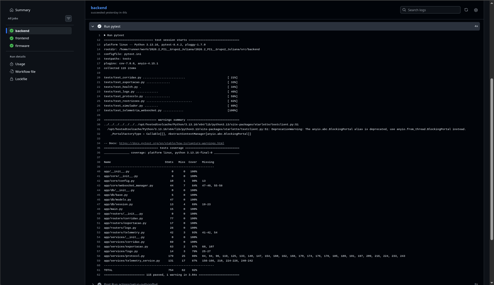
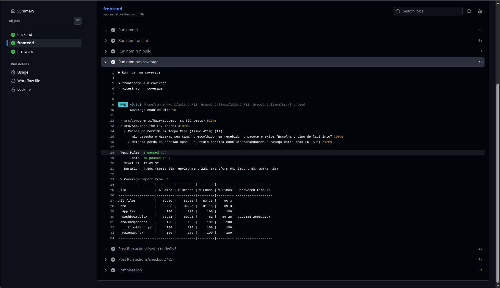
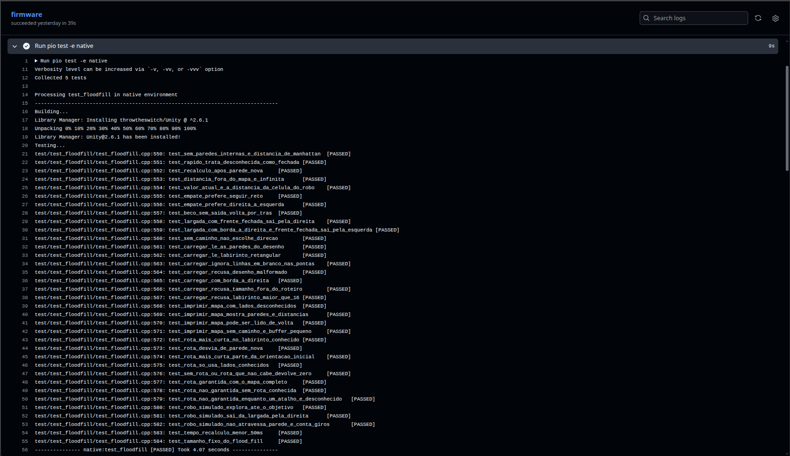
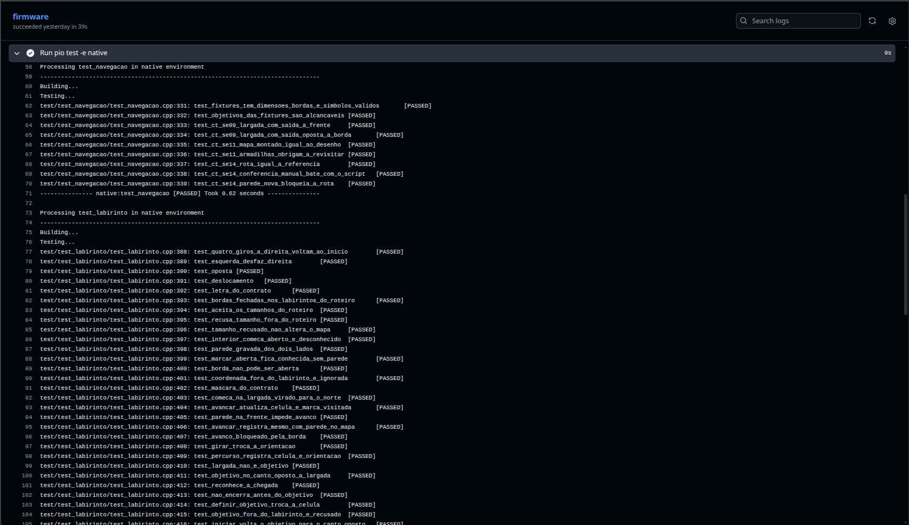
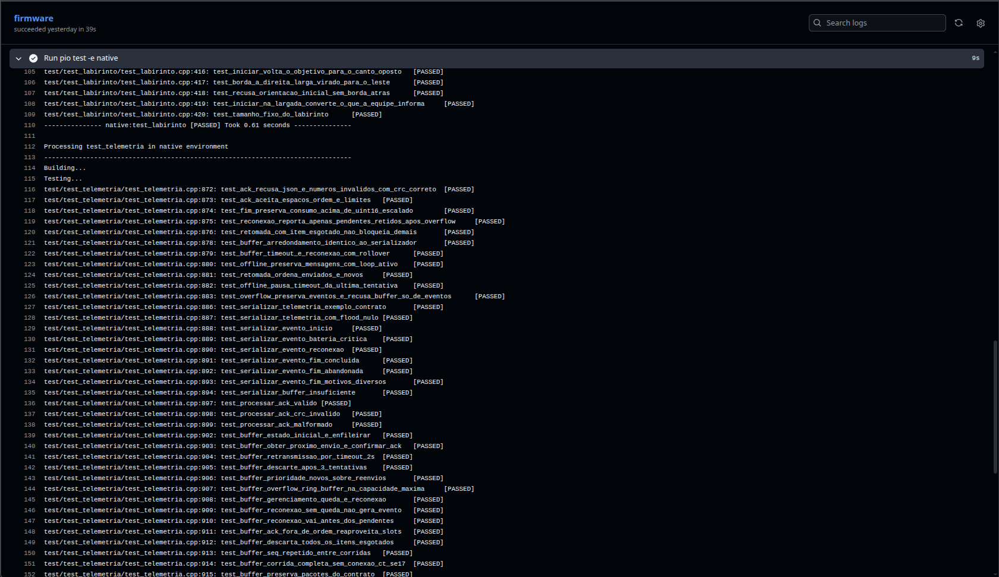
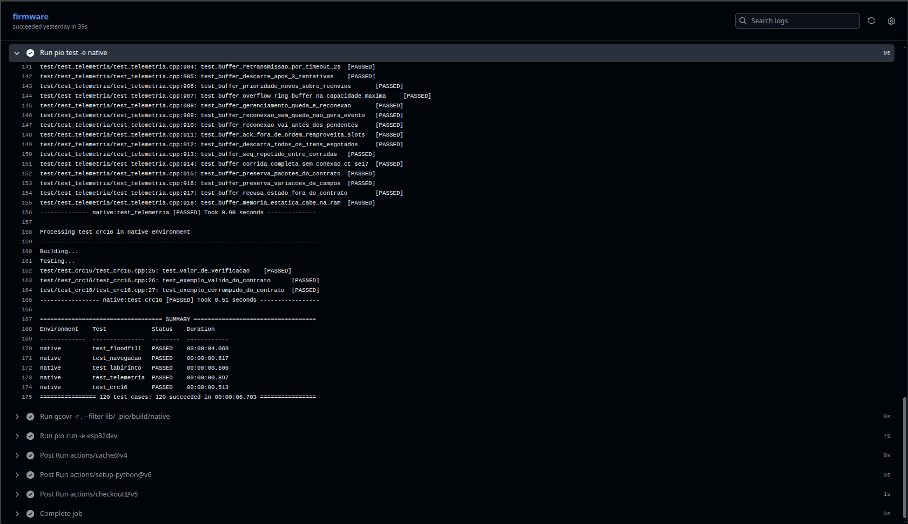
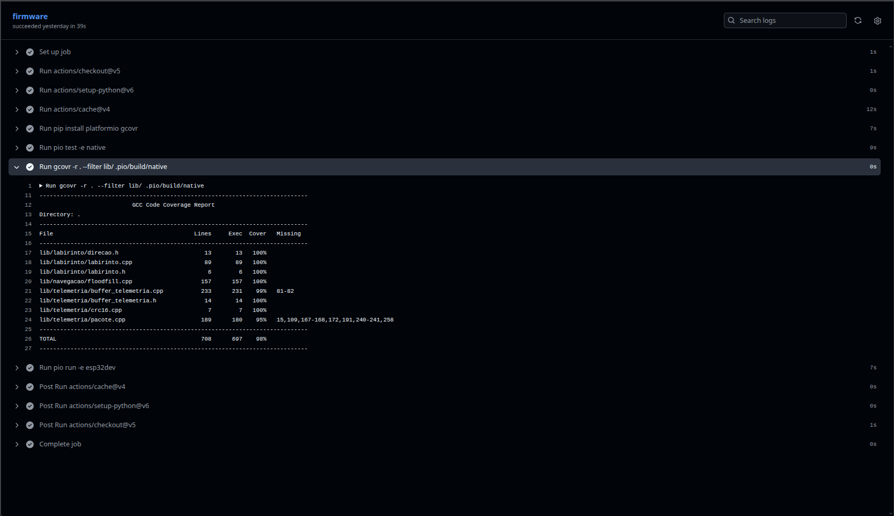
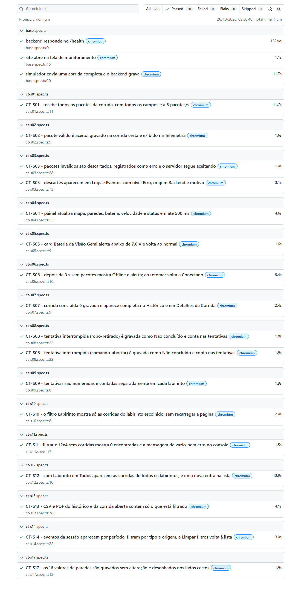

# Testes de Software
## Testes de _software_

> Apresentar com detalhes os testes feitos para conferir se os objetivos do *software* foram atendidos.
>
> - Listar as histórias de usuários e seus respectivos protótipos  implementadas.
> - Associar as histórias de usuários e os casos de testes funcionais implementados.
> - Enviar o print da execução dos suítes de testes automatizados em nível:
>   - Unitário e integração, com cobertura de código-fonte de pelo menos 80%;
>   - Sistema, do tipo funcional (end-to-end E2E).
>
> **Observações:**
>
> 1. Em relação ao *backlog* do produto, será considerado como referência aquele descrito no primeiro ponto de controle, contemplando as correções e *feedbacks* da-os professora(e)s. O ideal seria a real atualização entre o planejado X realizado.
> 2. Os testes mencionados nesta subseção dizem respeito aos testes de *software*. O Roteiro de testes funcionais, entregue no primeiro ponto de controle deve ser corrigido a partir do apontamento da-os professora(e)s. Além disso, ele deve guiar a execução dos testes E2E automatizados. O conjunto de casos de testes funcionais documentados devem estar coerentes com a automação via interface gráfica de entrada de dados.
>
> Exemplos de ferramentas de teste funcionais E2E:
>
> - Selenium
> - Cypress
> - Playwright
>
> Exemplos de ferramentas de testes em nível unitário e integração:
>
> - Jest
> - unittest
> - pytest
> - tox
> - gTest
> - Catch2

## 1. Histórias de usuário e protótipos implementados

<!-- Responsável: 3.9.4.5 (Rastreabilidade). Usar como referência o backlog do 4.4.1 e os protótipos do 4.4.2. -->

| **História de usuário** | **Descrição** | **Protótipo (Figma)** | **Situação** |
|-------------------------|---------------|-----------------------|--------------|
| | | | |

## 2. Rastreabilidade entre histórias de usuário e casos de teste

<!-- Responsável: 3.9.4.5 (Rastreabilidade). Casos de teste do roteiro 4.4.6 (CT-S e CT-SE). -->

| **História de usuário** | **Requisito** | **Caso de teste** | **Tipo (unitário / integração / E2E)** | **Resultado** |
|-------------------------|---------------|-------------------|----------------------------------------|---------------|
| | | | | |

### Planejado × realizado

<!-- O que foi planejado no primeiro ponto de controle e o que foi de fato entregue. -->

## 3. Testes unitários e de integração

<!-- Responsável: 3.9.4.2 (Cobertura). -->

Os testes unitários e de integração rodam automaticamente no GitHub Actions (*workflow* `CI`, arquivo [`.github/workflows/ci.yml`](../.github/workflows/ci.yml)) a cada *pull request* e a cada *push* nas *branches* `main` e `develop`. Cada parte do *software* tem um *job* próprio, que executa os testes e gera o relatório de cobertura.

Os testes estão divididos em dois níveis:

- **Unitários:** verificam uma parte isolada do código. Exemplos: a validação dos pacotes de telemetria no *backend*, o desenho do labirinto (`MazeMap`) no *frontend*, e o cálculo do CRC16, o mapa do labirinto e o *flood fill* no firmware.
- **Integração:** verificam várias partes funcionando juntas. No *backend*, as rotas HTTP e o WebSocket são testados com um banco PostgreSQL real. Cada teste roda dentro de uma transação desfeita no final, então nenhum teste deixa dados no banco. No *frontend*, o painel completo (`App`) é renderizado com os componentes reais, incluindo a troca de abas e o alerta de perda de conexão (CT-S06). No firmware, o *flood fill* e o mapa do labirinto são testados junto com um robô simulado, que só enxerga o que os três sensores veriam, nos labirintos do roteiro (CT-SE09, CT-SE11 e CT-SE14).

### 3.1 Ferramentas

| **Parte** | **Ferramenta de teste** | **Ferramenta de cobertura** |
|-----------|-------------------------|-----------------------------|
| *Backend* (Python/FastAPI) | pytest 8.4.2 | pytest-cov 7.0.0 (coverage.py) |
| *Frontend* (React) | Vitest 5.0.3, Testing Library e jsdom | @vitest/coverage-v8 |
| Firmware (C++/ESP32) | Unity 2.6.1 via PlatformIO, no ambiente `native` (roda no computador, sem o robô) | gcov e gcovr |

### 3.2 Resultado da cobertura

Execução de referência: [CI nº 39992180549](https://github.com/fcte-pi1/2026.2_PI1__Grupo2_Juliana/actions/runs/39992180549), na *branch* `develop`, *commit* `f70bb7c`, em 23/10/2026.

| **Parte** | **Testes executados** | **Cobertura** | **Meta** | **Situação** |
|-----------|-----------------------|---------------|----------|--------------|
| *Backend* | 115 aprovados | **92%** das instruções (692 de 754) | 80% | Atingida |
| *Frontend* | 69 aprovados | **90,3%** das linhas (89,9% das instruções, 83,1% dos desvios, 83,8% das funções) | 80% | Atingida |
| Firmware | 120 aprovados | **98%** das linhas (697 de 708) | 80% | Atingida |

As três partes passaram da meta de 80% no total. Individualmente, apenas dois arquivos ficaram abaixo da meta:

- `app/db/session.py` (69%), no *backend*: a função `session_scope` abre a sessão do banco usada pelo servidor em produção. Nos testes, o banco é acessado por uma conexão própria, com transação desfeita no final, e por isso essa função não é executada.
- `app/services/logs.py` (79%), no *backend*: as linhas não executadas são o tratamento de erro quando o banco falha ao gravar um evento (*rollback*).

### 3.3 Evidências de execução

**Cobertura do *backend* (pytest + pytest-cov):**



**Cobertura do *frontend* (Vitest + v8):**



**Testes do firmware (PlatformIO + Unity):**









**Cobertura do firmware (gcovr):**



### 3.4 Como reproduzir

Os comandos abaixo são os mesmos executados pelo CI.

**Backend** (requer Docker e o arquivo `.env` configurado conforme o [README do *backend*](../src/backend/README.md)):

```bash
cd src/backend
docker compose up -d                  # sobe o PostgreSQL
pip install -r requirements-dev.txt
alembic upgrade head                  # cria as tabelas
pytest                                # roda os testes e mostra a cobertura (configurado no pytest.ini)
```

**Frontend:**

```bash
cd src/frontend
npm ci
npm run coverage
```

**Firmware:**

```bash
cd src/firmware
pip install platformio gcovr
pio test -e native                             # roda os testes no computador
gcovr -r . --filter lib/ .pio/build/native     # mostra a cobertura da pasta lib/
```

### 3.5 Código fora da medição

Alguns trechos do código ficam de fora do cálculo da cobertura. Os motivos estão abaixo.

| **Parte** | **O que fica de fora** | **Motivo** |
|-----------|------------------------|------------|
| Firmware | `src/main.cpp` e os *drivers* de hardware (motores, *encoders* e sensores) | Esse código depende da biblioteca Arduino e dos periféricos do ESP32, e não roda no computador. Por isso, a lógica do robô fica separada em `lib/` (labirinto, navegação e telemetria), que é testada e medida. A parte de hardware é validada nos testes embarcados (CT-SE) com o robô físico. Mesmo sem medição, o CI compila o firmware para o ESP32 (`pio run -e esp32dev`) a cada mudança. Hoje o `main.cpp` só inicia a comunicação serial. |
| Firmware | Detecção de paredes e filtro de ruído dos sensores (RF01-S e RF14-S) | Ficou para a próxima entrega. Os limites de distância e o filtro precisam ser calibrados com o carrinho montado. Por isso, esse código ainda não foi integrado e não aparece na medição. |
| *Frontend* | `src/main.tsx` e os arquivos de teste | O `main.tsx` só monta a aplicação React na página e não tem lógica própria. Os arquivos de teste não são código do sistema. |
| *Backend* | `simulador.py` e `migrations/` | O simulador é uma ferramenta de apoio que imita o robô para testar o sistema web sem o hardware. Ele tem testes próprios (`test_simulador.py`), mas não faz parte do servidor. As *migrations* criam as tabelas do banco e são executadas pelo CI (`alembic upgrade head`) antes dos testes. |

## 4. Testes de sistema (E2E)

Os testes de sistema seguem o [Roteiro de Testes Funcionais (4.4.6)](./4.4.6%20-%20Roteiro%20de%20testes%20funcionais.md): cada caso CT-S do roteiro tem um arquivo de teste em [`src/e2e/tests/`](../src/e2e/tests), com o mesmo código no nome (`ct-s01.spec.ts`, `ct-s02.spec.ts` e assim por diante). Os testes abrem o site em um navegador de verdade e conferem o que o usuário vê na tela, e também o que ficou gravado no banco de dados.

### 4.1 Ferramenta

| **Item** | **Descrição** |
|----------|---------------|
| Ferramenta | [Playwright](https://playwright.dev/) com o navegador Chromium |
| Onde roda | No computador de quem desenvolve (`npx playwright test` em `src/e2e`) e no GitHub Actions (*job* `e2e` do *workflow* `CI`, arquivo [`.github/workflows/ci.yml`](../.github/workflows/ci.yml)), a cada *pull request* |
| O que sobe em cada execução | Banco PostgreSQL, *backend*, *frontend* e o [simulador de telemetria](../src/backend/simulador.py) no lugar do robô |
| Banco de dados | Um banco separado (`micromouse_e2e`), apagado antes de cada caso. O banco de desenvolvimento não é tocado |
| Robô | O simulador cobre os cenários de falha (pacote corrompido, bateria crítica e queda de conexão). Os casos que precisam de valores exatos usam um robô falso que fala o mesmo contrato de telemetria ([4.4.7](./4.4.7%20-%20Contrato%20de%20Telemetria.md)) direto pelo WebSocket |
| Relatório | O Playwright gera um relatório HTML da execução, que o CI guarda como artefato (`playwright-report`) por 14 dias |

Para o resultado ser o mesmo a cada execução, os testes não usam espera de tempo fixo: esperam a tela ou o banco chegarem ao valor esperado. O simulador roda na velocidade real e com a mesma semente, então o labirinto é sempre o mesmo. As regras completas estão no [README dos testes E2E](../src/e2e/README.md).

### 4.2 Casos automatizados

Todos os casos CT-S do roteiro estão automatizados. O CT-S15 e o CT-S16 (*login*) foram removidos do roteiro porque a autenticação (RF21-S) saiu do escopo.

| **Caso de teste** | **Descrição** | **Requisito / história** | **Resultado** |
|-------------------|---------------|--------------------------|---------------|
| CT-S01 | Recepção de telemetria: uma corrida 4x4 inteira. Todo pacote recebe confirmação (*ack*), nenhum se perde, todos os campos do contrato chegam e a taxa é de 5 pacotes por segundo | RF05-S / #88 | Aprovado |
| CT-S02 | Pacote válido é aceito, gravado na corrida certa e exibido na tela Telemetria | RF24-S / #107; RF05-S / #88 | Aprovado |
| CT-S03 | Pacote corrompido (*checksum* errado, campo ausente, paredes fora do intervalo e célula inexistente) é descartado, vira log de erro com o motivo (também na tela Logs e Eventos) e o servidor continua aceitando pacotes válidos | RF24-S / #107; RF20-S / #103 | Aprovado |
| CT-S04 | Monitoramento em tempo real: mapa, paredes, bateria, velocidade e status atualizam em até 500 ms | RF06-S / #89; RNF06-S | Aprovado |
| CT-S05 | Bateria abaixo de 7,0 V mostra o alerta de bateria crítica e volta ao normal quando a tensão sobe | RF19-S / #102 | Aprovado |
| CT-S06 | Depois de 3 s sem pacotes o painel mostra Offline e o alerta de conexão perdida. Ao retomar o envio, volta a Conectado | RF19-S / #102 | Aprovado |
| CT-S07 | Corrida concluída é gravada e aparece completa no Histórico e em Detalhes da Corrida | RF07-S / #90 | Aprovado |
| CT-S08 | Tentativa não concluída (robô retirado e comando de abortar) é gravada como "Não concluído" e conta nas tentativas | RF07-S / #90; RF10-S / #93 | Aprovado |
| CT-S09 | As tentativas são numeradas e contadas separadamente em cada labirinto | RF10-S / #93 | Aprovado |
| CT-S10 | O filtro Labirinto mostra só as corridas do labirinto escolhido, sem recarregar a página | RF08-S / #91 | Aprovado |
| CT-S11 | Filtrar um labirinto sem corridas mostra "0 encontradas" e a mensagem de lista vazia, sem erro | RF08-S / #91 | Aprovado |
| CT-S12 | Com o filtro em Todos aparecem as corridas de todos os labirintos, e uma corrida nova entra na lista | RF09-S / #92 | Aprovado |
| CT-S13 | Exportação em CSV e PDF do histórico e da corrida aberta, com só o que está filtrado | RF18-S / #101 | Aprovado |
| CT-S14 | Os eventos da sessão aparecem por período, filtram por tipo e origem, e "Limpar filtros" volta à lista completa | RF20-S / #103 | Aprovado |
| CT-S17 | Os 16 valores possíveis do campo `paredes` são gravados sem alteração e desenhados nos lados certos do mapa | RF05-S / #88; RF06-S / #89 | Aprovado |

Observações:

- No CT-S13, o botão "Exportar PDF" abre a impressão do navegador. O teste confere que a impressão foi chamada e gera o PDF com o próprio Playwright.
- O CT-S06 depende de um intervalo de tempo (3 s sem pacotes). Em uma execução de 5 repetições da suíte inteira ele falhou uma vez, e não se repetiu em mais de 100 execuções seguintes. Se voltar a falhar no CI, o ponto a revisar é o limite superior de 1 s depois dos 3 s.

### 4.3 Evidências de execução

Resultado da última execução da suíte inteira, em 26/10/2026: 20 testes (15 casos do roteiro, alguns com mais de um teste, mais 3 testes de infraestrutura em `base.spec.ts`), todos aprovados, em 1,5 minuto.



Cada caso também gera as evidências pedidas no roteiro (capturas de tela, consultas ao banco em CSV, log do simulador e tempos medidos), guardadas em [`docs/evidencias/<caso>/`](./evidencias) com um relatório de execução em `.md` por caso.

Para reproduzir:

```bash
cd src/backend && docker compose up -d     # banco
cd ../frontend && npm install
cd ../e2e && npm install && npx playwright install chromium
npx playwright test                         # roda tudo
E2E_EVIDENCIAS=1 npx playwright test       # roda e grava em docs/evidencias/
```
