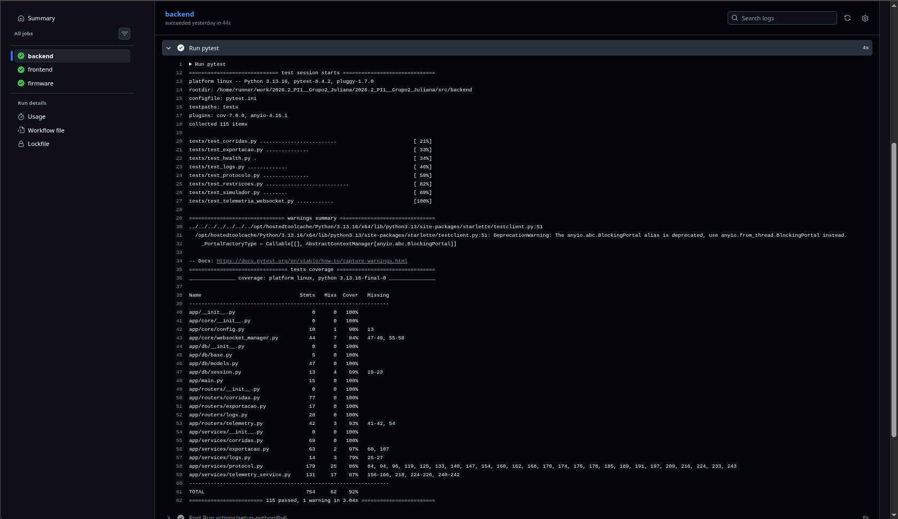
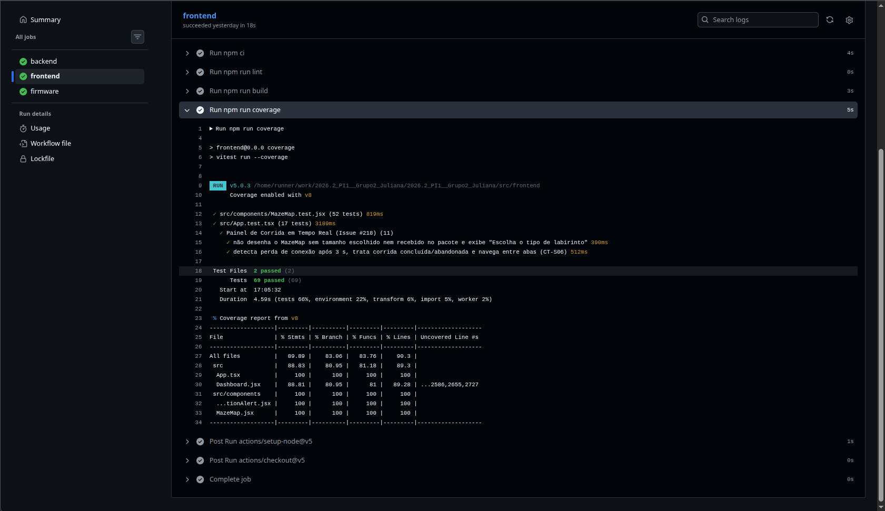
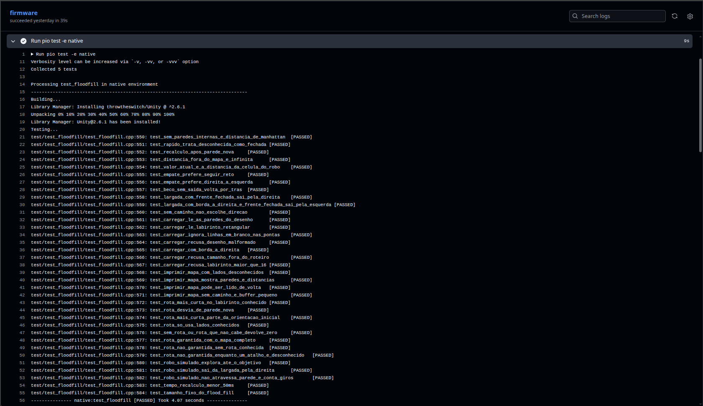
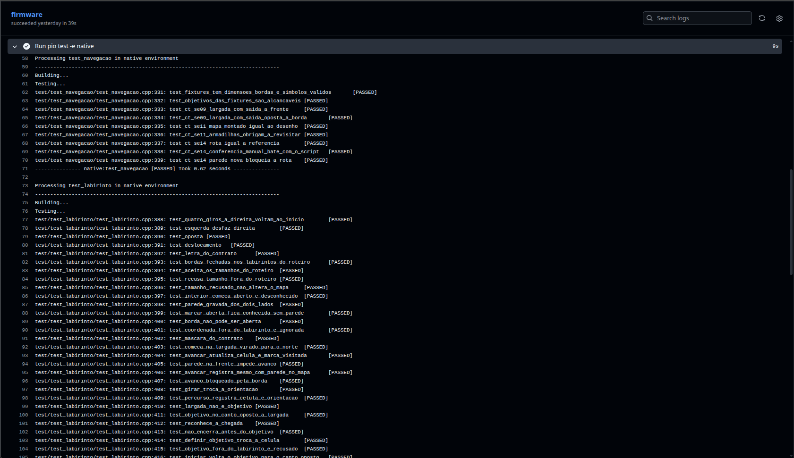
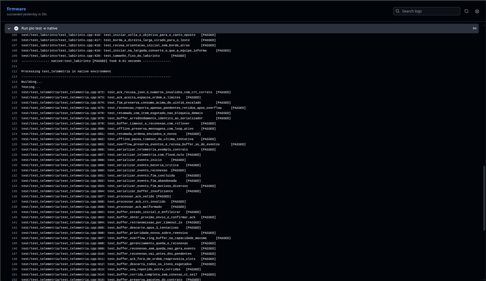
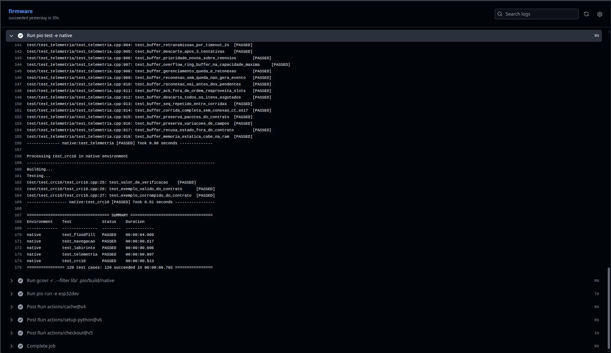
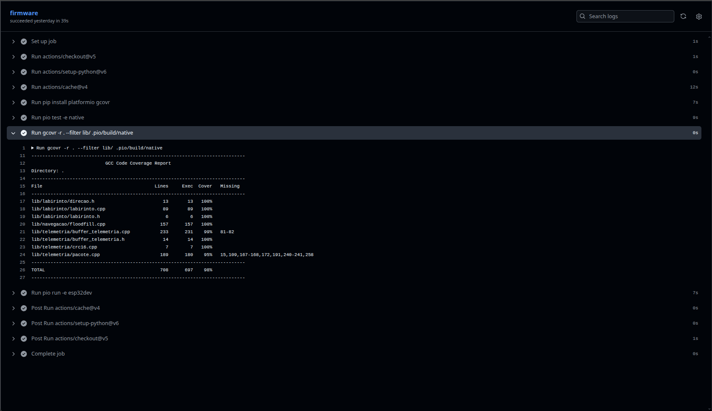
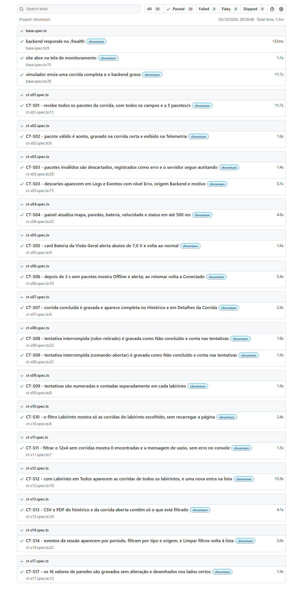

# Testes de Software
## Testes de _software_

Este documento detalha os testes realizados para atestar a qualidade e o funcionamento das frentes de software (back-end, front-end e firmware) do Micromouse. A seguir, são apresentadas as matrizes de rastreabilidade entre os requisitos, as telas reais implementadas e os Casos de Teste (CT) validados, além dos relatórios de cobertura de código e da comprovação de execução dos testes de sistema (E2E).

## 1. Histórias de usuário e protótipos implementados

As descrições seguem os [requisitos de software](./2%20-%20Requisitos.md) e as histórias do [backlog do produto (4.4.1)](./4.4.1%20-%20Backlog%20do%20Produto.md). Esta tabela contempla os requisitos funcionais RF01-S a RF25-S e os não funcionais RNF01-S a RNF15-S. Para cada um, indica a tela do [protótipo de interface (4.4.2)](./4.4.2%20-%20Prototipos%20de%20Interface.md) que o atende, quando existe, e o print da tela real implementada. Requisitos sem tela correspondente (controle do robô, fora do escopo ou não funcionais) estão indicados como N/A.

| **ID** | **Descrição** | **Protótipo (Figma)** | **Print da tela real** |
|:---:|---|---|---|
| RF01-S | Detectar paredes nas quatro direções da célula atual: frente e laterais pela leitura dos 3 sensores de distância (VL53L0X) e parede traseira por giro de 180° na célula de partida ou por inferência nas demais células | [Monitoramento](./4.4.2%20-%20Prototipos%20de%20Interface.md#2-monitoramento-em-tempo-real) | [Ver print](./figs/software/RF-01S.png) |
| RF02-S | Manter registro da célula e da orientação atuais ao longo de todo o percurso | [Monitoramento](./4.4.2%20-%20Prototipos%20de%20Interface.md#2-monitoramento-em-tempo-real) | [Ver print](./figs/software/RF-02S.png) |
| RF03-S | Movimentar-se célula a célula de forma alinhada, sem colisão com as paredes | [Monitoramento](./4.4.2%20-%20Prototipos%20de%20Interface.md#2-monitoramento-em-tempo-real) | [Ver print](./figs/software/RF-03S.png) |
| RF04-S | Identificar autonomamente a chegada ao objetivo e encerrar a corrida | [Monitoramento](./4.4.2%20-%20Prototipos%20de%20Interface.md#2-monitoramento-em-tempo-real) | [Ver print](./figs/software/RF-04S.png) |
| RF05-S | Formatar e enviar os dados de execução do micromouse via protocolo de comunicação para o sistema web | [Monitoramento](./4.4.2%20-%20Prototipos%20de%20Interface.md#2-monitoramento-em-tempo-real) | [Ver print](./figs/software/RF-05S.png) |
| RF06-S | Exibir no sistema web dados do percurso, bateria, velocidade e status em tempo real | [Monitoramento](./4.4.2%20-%20Prototipos%20de%20Interface.md#2-monitoramento-em-tempo-real) | [Ver print](./figs/software/RF-06S.png) |
| RF07-S | Armazenar em banco de dados os dados da corrida ao final de cada tentativa/desafio, seja ela concluída, abortada ou interrompida, registrando o status final | [Histórico e Detalhes](./4.4.2%20-%20Prototipos%20de%20Interface.md#3-hist%C3%B3rico-e-detalhes-das-corridas) | [Ver print](./figs/software/RF-07S.png) |
| RF08-S | Permitir consultar os dados armazenados filtrando por um labirinto específico | [Histórico e Detalhes](./4.4.2%20-%20Prototipos%20de%20Interface.md#3-hist%C3%B3rico-e-detalhes-das-corridas) | [Ver print](./figs/software/RF-08S.png) |
| RF09-S | Permitir consultar os dados de todos os labirintos de uma vez | [Histórico e Detalhes](./4.4.2%20-%20Prototipos%20de%20Interface.md#3-hist%C3%B3rico-e-detalhes-das-corridas) | [Ver print](./figs/software/RF-09S.png) |
| RF10-S | Registrar e contabilizar o número de tentativas por labirinto | [Histórico e Detalhes](./4.4.2%20-%20Prototipos%20de%20Interface.md#3-hist%C3%B3rico-e-detalhes-das-corridas) | [Ver print](./figs/software/RF-10S.png) |
| RF11-S | Construir o mapa do labirinto dinamicamente durante a execução. O sistema deve explorar e mapear as células de forma autônoma utilizando um algoritmo eficiente para armazenar a configuração, sem necessitar de um mapa pré-carregado. | [Monitoramento](./4.4.2%20-%20Prototipos%20de%20Interface.md#2-monitoramento-em-tempo-real) | [Ver print](./figs/software/RF-11S.png) |
| RF12-S | Processar o mapa acumulado para calcular a rota ideal/mais curta até o Final do labirinto | [Monitoramento](./4.4.2%20-%20Prototipos%20de%20Interface.md#2-monitoramento-em-tempo-real) | [Ver print](./figs/software/RF-12S.png) |
| RF13-S | Realizar percurso otimizado com velocidade utilizando o menor caminho previamente calculado | [Monitoramento](./4.4.2%20-%20Prototipos%20de%20Interface.md#2-monitoramento-em-tempo-real) | [Ver print](./figs/software/RF-13S.png) |
| RF14-S | Aplicar tratamento digital aos dados brutos dos sensores para mitigar leituras falsas | N/A | N/A |
| RF15-S | Controlar os motores utilizando controle proporcional-integral-derivativo para alinhamento | N/A | N/A |
| RF16-S | Detectar e corrigir desvios de alinhamento ou pequenas colisões durante o trajeto | N/A | N/A |
| RF17-S | Executar rotina de calibração de sensores de distância e encoders ao inicializar | N/A | N/A |
| RF18-S | Permitir exportar relatórios de desempenho e histórico de corridas (ex: PDF ou CSV) | [Histórico e Detalhes](./4.4.2%20-%20Prototipos%20de%20Interface.md#3-hist%C3%B3rico-e-detalhes-das-corridas) | [Ver print](./figs/software/RF-18S.png) |
| RF19-S | Exibir alertas visuais no sistema web sobre nível crítico de bateria ou perda de conexão | [Visão Geral](./4.4.2%20-%20Prototipos%20de%20Interface.md#1-vis%C3%A3o-geral-dashboard), [Monitoramento](./4.4.2%20-%20Prototipos%20de%20Interface.md#2-monitoramento-em-tempo-real) | [Ver print](./figs/software/RF-19S.png) |
| RF20-S | Registrar histórico de logs de sistema para depuração de erros de software e hardware | [Logs e Eventos](./4.4.2%20-%20Prototipos%20de%20Interface.md#4-logs-e-eventos-do-sistema) | [Ver print](./figs/software/RF-20S.png) |
| RF21-S | Autenticação de Usuários no Sistema Web | N/A | N/A (Retirado do escopo) |
| RF22-S | Atualização de Firmware via OTA | N/A | N/A (sem tela; implementado no firmware, ver Seção 5) |
| RF23-S | Partida em Beco sem Saída | [Monitoramento](./4.4.2%20-%20Prototipos%20de%20Interface.md#2-monitoramento-em-tempo-real) | [Ver print](./figs/software/RF-23S.jpeg) |
| RF24-S | Validação de Pacotes de Telemetria | [Logs e Eventos](./4.4.2%20-%20Prototipos%20de%20Interface.md#4-logs-e-eventos-do-sistema) | N/A |
| RF25-S | Armazenamento Local de Telemetria | [Logs e Eventos](./4.4.2%20-%20Prototipos%20de%20Interface.md#4-logs-e-eventos-do-sistema) | [Ver print](./figs/software/RF-25S.jpeg) |
| RNF01-S | Tempo de Resposta do Algoritmo | N/A | N/A |
| RNF02-S | Confiabilidade de Navegação | N/A | N/A |
| RNF03-S | Uso Eficiente de Memória | N/A | N/A |
| RNF04-S | Disponibilidade do Sistema Web | N/A | N/A |
| RNF05-S | Usabilidade da Interface | N/A | N/A |
| RNF06-S | Latência de Telemetria | N/A | N/A |
| RNF07-S | Integridade dos Dados Armazenados | N/A | N/A |
| RNF08-S | Manutenibilidade | N/A | N/A |
| RNF09-S | Portabilidade do Código | N/A | N/A |
| RNF10-S | Testabilidade | N/A | N/A |
| RNF11-S | Design Responsivo | N/A | N/A |
| RNF12-S | Tolerância a Falhas na Comunicação | N/A | N/A |
| RNF13-S | Concorrência e Escala de Conexões | N/A | N/A |
| RNF14-S | Segurança na Comunicação | N/A | N/A |
| RNF15-S | Independência de Conexão na Navegação | N/A | N/A |

## 2. Rastreabilidade entre histórias de usuário e casos de teste

A associação abaixo segue a matriz do [Roteiro de Testes Funcionais (4.4.6)](./4.4.6%20-%20Roteiro%20de%20testes%20funcionais.md). Os CT-S são testes E2E do sistema web, com resultados e evidências na Seção 4. Os CT-SE são testes funcionais do sistema embarcado, classificados aqui como E2E por verificarem o comportamento do robô no cenário descrito pelo roteiro. O resultado de cada CT-SE, com a evidência usada (teste automatizado do firmware, ensaio na bancada ou pendente do robô andando), está na Seção 5. Os testes unitários e de integração são apresentados na Seção 3.

| **História de usuário** | **Requisito** | **Caso de teste** | **Tipo (unitário / integração / E2E)** | **Resultado** |
|---|:---:|---|---|---|
| [HU #78](https://github.com/fcte-pi1/2026.2_PI1__Grupo2_Juliana/issues/78) | RF01-S | [CT-SE03](./4.4.6%20-%20Roteiro%20de%20testes%20funcionais.md#ct-se03---detec%C3%A7%C3%A3o-de-paredes), [CT-SE19](./4.4.6%20-%20Roteiro%20de%20testes%20funcionais.md#ct-se19---resolu%C3%A7%C3%A3o-completa-dos-tr%C3%AAs-labirintos) | E2E (embarcado) | Parcial: aprovado nos testes do firmware e com os sensores na bancada; no labirinto, pendente (Seção 5) |
| [HU #84](https://github.com/fcte-pi1/2026.2_PI1__Grupo2_Juliana/issues/84) | RF02-S | [CT-SE06](./4.4.6%20-%20Roteiro%20de%20testes%20funcionais.md#ct-se06---curvas-de-90-e-180), [CT-SE10](./4.4.6%20-%20Roteiro%20de%20testes%20funcionais.md#ct-se10---registro-de-c%C3%A9lula-e-orienta%C3%A7%C3%A3o), [CT-SE19](./4.4.6%20-%20Roteiro%20de%20testes%20funcionais.md#ct-se19---resolu%C3%A7%C3%A3o-completa-dos-tr%C3%AAs-labirintos) | E2E (embarcado) | Parcial: aprovado nos testes do firmware; com o robô andando, pendente |
| [HU #86](https://github.com/fcte-pi1/2026.2_PI1__Grupo2_Juliana/issues/86) | RF03-S | [CT-SE05](./4.4.6%20-%20Roteiro%20de%20testes%20funcionais.md#ct-se05---movimenta%C3%A7%C3%A3o-em-linha-reta), [CT-SE06](./4.4.6%20-%20Roteiro%20de%20testes%20funcionais.md#ct-se06---curvas-de-90-e-180), [CT-SE19](./4.4.6%20-%20Roteiro%20de%20testes%20funcionais.md#ct-se19---resolu%C3%A7%C3%A3o-completa-dos-tr%C3%AAs-labirintos) | E2E (embarcado) | Pendente: os motores não partem de forma confiável (Seção 5.4) |
| [HU #87](https://github.com/fcte-pi1/2026.2_PI1__Grupo2_Juliana/issues/87) | RF04-S | [CT-SE12](./4.4.6%20-%20Roteiro%20de%20testes%20funcionais.md#ct-se12---identifica%C3%A7%C3%A3o-do-objetivo), [CT-SE13](./4.4.6%20-%20Roteiro%20de%20testes%20funcionais.md#ct-se13---n%C3%A3o-encerramento-antes-do-objetivo), [CT-SE19](./4.4.6%20-%20Roteiro%20de%20testes%20funcionais.md#ct-se19---resolu%C3%A7%C3%A3o-completa-dos-tr%C3%AAs-labirintos) | E2E (embarcado) | Parcial: aprovado nos testes do firmware (robô simulado); no labirinto, pendente |
| [HU #88](https://github.com/fcte-pi1/2026.2_PI1__Grupo2_Juliana/issues/88) | RF05-S | [CT-S01](./4.4.6%20-%20Roteiro%20de%20testes%20funcionais.md#ct-s01---recep%C3%A7%C3%A3o-de-telemetria-do-micromouse), [CT-S02](./4.4.6%20-%20Roteiro%20de%20testes%20funcionais.md#ct-s02---aceita%C3%A7%C3%A3o-de-pacote-de-telemetria-v%C3%A1lido), [CT-S17](./4.4.6%20-%20Roteiro%20de%20testes%20funcionais.md#ct-s17---codifica%C3%A7%C3%A3o-das-paredes-no-pacote-de-telemetria) | E2E (web) | Aprovado |
| [HU #89](https://github.com/fcte-pi1/2026.2_PI1__Grupo2_Juliana/issues/89) | RF06-S | [CT-S04](./4.4.6%20-%20Roteiro%20de%20testes%20funcionais.md#ct-s04---monitoramento-da-corrida-em-tempo-real), [CT-S17](./4.4.6%20-%20Roteiro%20de%20testes%20funcionais.md#ct-s17---codifica%C3%A7%C3%A3o-das-paredes-no-pacote-de-telemetria) | E2E (web) | Aprovado |
| [HU #90](https://github.com/fcte-pi1/2026.2_PI1__Grupo2_Juliana/issues/90) | RF07-S | [CT-S07](./4.4.6%20-%20Roteiro%20de%20testes%20funcionais.md#ct-s07---persist%C3%AAncia-dos-dados-finais), [CT-S08](./4.4.6%20-%20Roteiro%20de%20testes%20funcionais.md#ct-s08---persist%C3%AAncia-de-tentativa-n%C3%A3o-conclu%C3%ADda) | E2E (web) | Aprovado |
| [HU #91](https://github.com/fcte-pi1/2026.2_PI1__Grupo2_Juliana/issues/91) | RF08-S | [CT-S10](./4.4.6%20-%20Roteiro%20de%20testes%20funcionais.md#ct-s10---consulta-por-labirinto), [CT-S11](./4.4.6%20-%20Roteiro%20de%20testes%20funcionais.md#ct-s11---consulta-de-labirinto-sem-registros) | E2E (web) | Aprovado |
| [HU #92](https://github.com/fcte-pi1/2026.2_PI1__Grupo2_Juliana/issues/92) | RF09-S | [CT-S12](./4.4.6%20-%20Roteiro%20de%20testes%20funcionais.md#ct-s12---consulta-geral-de-resultados) | E2E (web) | Aprovado |
| [HU #93](https://github.com/fcte-pi1/2026.2_PI1__Grupo2_Juliana/issues/93) | RF10-S | [CT-S08](./4.4.6%20-%20Roteiro%20de%20testes%20funcionais.md#ct-s08---persist%C3%AAncia-de-tentativa-n%C3%A3o-conclu%C3%ADda), [CT-S09](./4.4.6%20-%20Roteiro%20de%20testes%20funcionais.md#ct-s09---controle-de-tentativas-por-labirinto) | E2E (web) | Aprovado |
| [HU #94](https://github.com/fcte-pi1/2026.2_PI1__Grupo2_Juliana/issues/94) | RF11-S | [CT-SE11](./4.4.6%20-%20Roteiro%20de%20testes%20funcionais.md#ct-se11---mapeamento-din%C3%A2mico-do-labirinto), [CT-SE19](./4.4.6%20-%20Roteiro%20de%20testes%20funcionais.md#ct-se19---resolu%C3%A7%C3%A3o-completa-dos-tr%C3%AAs-labirintos) | E2E (embarcado) | Parcial: aprovado nos testes do firmware e no ESP32 com labirinto simulado; no labirinto físico, pendente |
| [HU #95](https://github.com/fcte-pi1/2026.2_PI1__Grupo2_Juliana/issues/95) | RF12-S | [CT-SE14](./4.4.6%20-%20Roteiro%20de%20testes%20funcionais.md#ct-se14---c%C3%A1lculo-de-menor-caminho) | E2E (embarcado) | Parcial: aprovado nos testes do firmware; no labirinto físico, pendente |
| [HU #96](https://github.com/fcte-pi1/2026.2_PI1__Grupo2_Juliana/issues/96) | RF13-S | [CT-SE15](./4.4.6%20-%20Roteiro%20de%20testes%20funcionais.md#ct-se15---modo-autom%C3%A1tico) | E2E (embarcado) | Parcial: máquina de estados aprovada nos testes do firmware; no robô, pendente |
| [HU #97](https://github.com/fcte-pi1/2026.2_PI1__Grupo2_Juliana/issues/97) | RF14-S | [CT-SE04](./4.4.6%20-%20Roteiro%20de%20testes%20funcionais.md#ct-se04---filtro-de-ru%C3%ADdo-nos-sensores) | E2E (embarcado) | Parcial: aprovado nos testes do firmware e na bancada (ruído de 3 a 13 mm parado); em movimento, pendente |
| [HU #98](https://github.com/fcte-pi1/2026.2_PI1__Grupo2_Juliana/issues/98) | RF15-S | [CT-SE07](./4.4.6%20-%20Roteiro%20de%20testes%20funcionais.md#ct-se07---controle-em-malha-fechada-pid) | E2E (embarcado) | Pendente: depende dos motores (Seção 5.4) |
| [HU #99](https://github.com/fcte-pi1/2026.2_PI1__Grupo2_Juliana/issues/99) | RF16-S | [CT-SE08](./4.4.6%20-%20Roteiro%20de%20testes%20funcionais.md#ct-se08---recupera%C3%A7%C3%A3o-de-erros-de-deslocamento) | E2E (embarcado) | Pendente: depende do robô andando |
| [HU #100](https://github.com/fcte-pi1/2026.2_PI1__Grupo2_Juliana/issues/100) | RF17-S | [CT-SE01](./4.4.6%20-%20Roteiro%20de%20testes%20funcionais.md#ct-se01---calibra%C3%A7%C3%A3o-inicial-autom%C3%A1tica), [CT-SE02](./4.4.6%20-%20Roteiro%20de%20testes%20funcionais.md#ct-se02---falha-na-calibra%C3%A7%C3%A3o) | E2E (embarcado) | Parcial: calibração dos sensores e da bateria aprovada na bancada; a dos motores, pendente |
| [HU #101](https://github.com/fcte-pi1/2026.2_PI1__Grupo2_Juliana/issues/101) | RF18-S | [CT-S13](./4.4.6%20-%20Roteiro%20de%20testes%20funcionais.md#ct-s13---exporta%C3%A7%C3%A3o-de-relat%C3%B3rios) | E2E (web) | Aprovado |
| [HU #102](https://github.com/fcte-pi1/2026.2_PI1__Grupo2_Juliana/issues/102) | RF19-S | [CT-S05](./4.4.6%20-%20Roteiro%20de%20testes%20funcionais.md#ct-s05---alerta-de-bateria-em-n%C3%ADvel-cr%C3%ADtico), [CT-S06](./4.4.6%20-%20Roteiro%20de%20testes%20funcionais.md#ct-s06---alerta-de-perda-de-conex%C3%A3o) | E2E (web) | Aprovado |
| [HU #103](https://github.com/fcte-pi1/2026.2_PI1__Grupo2_Juliana/issues/103) | RF20-S | [CT-S03](./4.4.6%20-%20Roteiro%20de%20testes%20funcionais.md#ct-s03---descarte-de-pacote-de-telemetria-corrompido), [CT-S14](./4.4.6%20-%20Roteiro%20de%20testes%20funcionais.md#ct-s14---log-de-eventos-e-erros), [CT-SE02](./4.4.6%20-%20Roteiro%20de%20testes%20funcionais.md#ct-se02---falha-na-calibra%C3%A7%C3%A3o) | E2E (web e embarcado) | CT-S03 e CT-S14: aprovados; CT-SE02: aprovado nos testes do firmware |
| [HU #104](https://github.com/fcte-pi1/2026.2_PI1__Grupo2_Juliana/issues/104) | RF21-S | Cancelado | N/A | Retirado do escopo |
| [HU #105](https://github.com/fcte-pi1/2026.2_PI1__Grupo2_Juliana/issues/105) | RF22-S | [CT-SE18](./4.4.6%20-%20Roteiro%20de%20testes%20funcionais.md#ct-se18---atualiza%C3%A7%C3%A3o-de-firmware-via-ota) | E2E (embarcado) | Aprovado na bancada (firmware de 994 KB gravado pelo Wi-Fi em 21 s) |
| [HU #106](https://github.com/fcte-pi1/2026.2_PI1__Grupo2_Juliana/issues/106) | RF23-S | [CT-SE09](./4.4.6%20-%20Roteiro%20de%20testes%20funcionais.md#ct-se09---partida-em-beco-sem-sa%C3%ADda) | E2E (embarcado) | Parcial: aprovado nos testes do firmware (robô simulado); no labirinto, pendente |
| [HU #107](https://github.com/fcte-pi1/2026.2_PI1__Grupo2_Juliana/issues/107) | RF24-S | [CT-S02](./4.4.6%20-%20Roteiro%20de%20testes%20funcionais.md#ct-s02---aceita%C3%A7%C3%A3o-de-pacote-de-telemetria-v%C3%A1lido), [CT-S03](./4.4.6%20-%20Roteiro%20de%20testes%20funcionais.md#ct-s03---descarte-de-pacote-de-telemetria-corrompido) | E2E (web) | Aprovado |
| [HU #108](https://github.com/fcte-pi1/2026.2_PI1__Grupo2_Juliana/issues/108) | RF25-S | [CT-SE16](./4.4.6%20-%20Roteiro%20de%20testes%20funcionais.md#ct-se16---armazenamento-local-de-telemetria), [CT-SE17](./4.4.6%20-%20Roteiro%20de%20testes%20funcionais.md#ct-se17---capacidade-do-armazenamento-local) | E2E (embarcado) | Parcial: aprovado nos testes do firmware (inclusive quedas de 5 s, 60 s e com o buffer cheio) e na bancada (153 de 153 acks); queda com o robô andando, pendente |
| [HU #117](https://github.com/fcte-pi1/2026.2_PI1__Grupo2_Juliana/issues/117) | RNF06-S | [CT-S04](./4.4.6%20-%20Roteiro%20de%20testes%20funcionais.md#ct-s04---monitoramento-da-corrida-em-tempo-real) | E2E (web) | Aprovado (painel atualiza em até 500 ms) |
| [HU #121](https://github.com/fcte-pi1/2026.2_PI1__Grupo2_Juliana/issues/121) | RNF10-S | Cobertura dos testes unitários e de integração | Unitário / integração | Aprovado (acima de 80% nas três partes, Seção 3.2) |
| [HU #123](https://github.com/fcte-pi1/2026.2_PI1__Grupo2_Juliana/issues/123) | RNF12-S | `test_restricoes.py` (reenvio após queda), [CT-S06](./4.4.6%20-%20Roteiro%20de%20testes%20funcionais.md#ct-s06---alerta-de-perda-de-conex%C3%A3o) | Integração / E2E (web) | Aprovado |
| [HU #112](https://github.com/fcte-pi1/2026.2_PI1__Grupo2_Juliana/issues/112) | RNF01-S | `test_tempo_recalculo_menor_50ms` e medição no ESP32 (Seção 5.1) | Unitário / bancada | Aprovado (recálculo de 45 µs em média e 52 µs no pior caso; meta de 50 ms) |
| [HU #113](https://github.com/fcte-pi1/2026.2_PI1__Grupo2_Juliana/issues/113) | RNF02-S | Corridas completas (Seção 5.1) | E2E (embarcado) | Parcial: 342 corridas simuladas no ESP32 sem erro; as 5 corridas no labirinto físico, pendentes |
| [HU #114](https://github.com/fcte-pi1/2026.2_PI1__Grupo2_Juliana/issues/114) | RNF03-S | Medição de memória no ESP32 (Seção 5.1) | Bancada | Aprovado (RAM estática 18,2%; ~98 KB livres em operação com o buffer de telemetria reservado) |
| [HU #112](https://github.com/fcte-pi1/2026.2_PI1__Grupo2_Juliana/issues/112) a [#126](https://github.com/fcte-pi1/2026.2_PI1__Grupo2_Juliana/issues/126) | Demais RNF-S | Sem caso de teste específico | N/A | Sem evidência própria |

### Planejado × realizado

Em relação ao *backlog* do produto do primeiro ponto de controle, a situação dos 25 requisitos funcionais é a seguinte:

* **Sistema web (10 requisitos):** RF05-S a RF10-S, RF18-S, RF19-S, RF20-S e RF24-S foram entregues e aprovados nos testes E2E automatizados (Seção 4).
* **Sistema embarcado (14 requisitos):** RF01-S a RF04-S, RF11-S a RF17-S, RF22-S, RF23-S e RF25-S. A lógica de navegação, a detecção de paredes, o filtro de ruído e o armazenamento local estão integrados no firmware da placa montada e aprovados nos testes do firmware (Seção 3) e, em parte, na bancada (Seção 5). A atualização via OTA (RF22-S) foi implementada e aprovada na bancada. O que exige o robô andando no labirinto (movimentação, PID, recuperação de erros e as corridas completas) está pendente: os motores não partem de forma confiável (Seção 5.4).
* **Fora do escopo:** o RF21-S (autenticação) foi retirado do escopo ([#221](https://github.com/fcte-pi1/2026.2_PI1__Grupo2_Juliana/issues/221)).
* **Requisitos não funcionais:** não há teste específico para cada RNF. Os que têm verificação são o RNF06-S (latência: o CT-S04 confere a atualização do painel em até 500 ms, e com o robô real o pior caso foi de 488 ms), o RNF12-S (reenvio após queda de conexão, nos testes do *backend*, no CT-S06 e nos cenários de queda do firmware), o RNF10-S (testabilidade, pela cobertura acima de 80% nas três partes), o RNF01-S (tempo do *flood fill*) e o RNF03-S (memória), estes dois medidos no ESP32 (Seção 5.1). Os demais ainda não têm evidência própria.
* **Cobertura:** a meta de 80% de cobertura dos testes unitários e de integração foi atingida no *backend*, no *frontend* e no firmware (Seção 3.2).

## 3. Testes unitários e de integração

Os testes unitários e de integração rodam automaticamente no GitHub Actions (*workflow* `CI`, arquivo [`.github/workflows/ci.yml`](../.github/workflows/ci.yml)) a cada *pull request* e a cada *push* nas *branches* `main` e `develop`. Cada parte do *software* tem um *job* próprio, que executa os testes e gera o relatório de cobertura.

Os testes estão divididos em dois níveis:

- **Unitários:** verificam uma parte isolada do código. Exemplos: a validação dos pacotes de telemetria no *backend*, o desenho do labirinto (`MazeMap`) no *frontend*, e o cálculo do CRC16, o mapa do labirinto e o *flood fill* no firmware.
- **Integração:** verificam várias partes funcionando juntas. No *backend*, as rotas HTTP e o WebSocket são testados com um banco PostgreSQL real. Cada teste roda dentro de uma transação desfeita no final, então nenhum teste deixa dados no banco. No *frontend*, o painel completo (`App`) é renderizado com os componentes reais, incluindo a troca de abas e o alerta de perda de conexão (CT-S06). No firmware, o *flood fill* e o mapa do labirinto são testados junto com um robô simulado, que só enxerga o que os três sensores veriam, nos labirintos do roteiro (CT-SE09, CT-SE11 e CT-SE14).

### 3.1 Ferramentas

| **Parte** | **Ferramenta de teste** | **Ferramenta de cobertura** |
|-----------|-------------------------|-----------------------------|
| *Backend* (Python/FastAPI) | pytest 8.4.2 | pytest-cov 7.0.0 (coverage.py) |
| *Frontend* (React) | Vitest 5.0.3, Testing Library e jsdom | @vitest/coverage-v8 |
| Firmware (C++/ESP32) | Unity 2.6.1 via PlatformIO, no ambiente `native` (roda no computador, sem o robô) | gcov e gcovr |

### 3.2 Resultado da cobertura

Execução de referência: [CI nº 44829369612](https://github.com/fcte-pi1/2026.2_PI1__Grupo2_Juliana/actions/runs/44829369612), na *branch* `feature/216-bateria-motores` ([PR #297](https://github.com/fcte-pi1/2026.2_PI1__Grupo2_Juliana/pull/297)), *commit* `c761bf5`, em 20/11/2026. As capturas da Seção 3.3 são da execução anterior, de 26/10/2026.

| **Parte** | **Testes executados** | **Cobertura** | **Meta** | **Situação** |
|-----------|-----------------------|---------------|----------|--------------|
| *Backend* | 115 aprovados | **92%** das instruções (692 de 754) | 80% | Atingida |
| *Frontend* | 58 aprovados | **89,9%** das linhas (89,5% das instruções, 82,0% dos desvios, 83,5% das funções) | 80% | Atingida |
| Firmware | 156 aprovados | **97%** das linhas (912 de 932) | 80% | Atingida |

As três partes passaram da meta de 80% no total. Individualmente, apenas dois arquivos ficaram abaixo da meta:

- `app/db/session.py` (69%), no *backend*: a função `session_scope` abre a sessão do banco usada pelo servidor em produção. Nos testes, o banco é acessado por uma conexão própria, com transação desfeita no final, e por isso essa função não é executada.
- `app/services/logs.py` (79%), no *backend*: as linhas não executadas são o tratamento de erro quando o banco falha ao gravar um evento (*rollback*).

### 3.3 Evidências de execução

**Cobertura do *backend* (pytest + pytest-cov):**



**Cobertura do *frontend* (Vitest + v8):**



**Testes do firmware (PlatformIO + Unity):**









**Cobertura do firmware (gcovr):**



### 3.4 Como reproduzir

Os comandos abaixo são os mesmos executados pelo CI.

**Backend** (requer Docker e o arquivo `.env` configurado conforme o [README do *backend*](../src/backend/README.md)):

```bash
cd src/backend
docker compose up -d                  # sobe o PostgreSQL
pip install -r requirements-dev.txt
alembic upgrade head                  # cria as tabelas
pytest                                # roda os testes e mostra a cobertura (configurado no pytest.ini)
```

**Frontend:**

```bash
cd src/frontend
npm ci
npm run coverage
```

**Firmware:**

```bash
cd src/firmware
pip install platformio gcovr
pio test -e native                             # roda os testes no computador
gcovr -r . --filter lib/ .pio/build/native     # mostra a cobertura da pasta lib/
```

### 3.5 Código fora da medição

Alguns trechos do código ficam de fora do cálculo da cobertura. Os motivos estão abaixo.

| **Parte** | **O que fica de fora** | **Motivo** |
|-----------|------------------------|------------|
| Firmware | `src/` (`main.cpp`, sensores, motores, Wi-Fi, OTA e a tarefa do núcleo 1) | Esse código depende da biblioteca Arduino e dos periféricos do ESP32, e não roda no computador. Por isso, a lógica do robô fica separada em `lib/` (labirinto, navegação, filtro dos sensores, bateria e telemetria), que é testada e medida. A parte de hardware é validada na bancada e nos testes embarcados (Seção 5). O CI compila o firmware para o ESP32 (`pio run -e esp32dev`) a cada mudança e confere que a navegação não cai no defeito do núcleo 1 (`nucleo1_verificar.py`). |
| *Frontend* | `src/main.tsx` e os arquivos de teste | O `main.tsx` só monta a aplicação React na página e não tem lógica própria. Os arquivos de teste não são código do sistema. |
| *Backend* | `simulador.py` e `migrations/` | O simulador é uma ferramenta de apoio que imita o robô para testar o sistema web sem o hardware. Ele tem testes próprios (`test_simulador.py`), mas não faz parte do servidor. As *migrations* criam as tabelas do banco e são executadas pelo CI (`alembic upgrade head`) antes dos testes. |

## 4. Testes de sistema (E2E)

Os testes de sistema seguem o [Roteiro de Testes Funcionais (4.4.6)](./4.4.6%20-%20Roteiro%20de%20testes%20funcionais.md): cada caso CT-S do roteiro tem um arquivo de teste em [`src/e2e/tests/`](../src/e2e/tests), com o mesmo código no nome (`ct-s01.spec.ts`, `ct-s02.spec.ts` e assim por diante). Os testes abrem o site em um navegador de verdade e conferem o que o usuário vê na tela, e também o que ficou gravado no banco de dados.

### 4.1 Ferramenta

| **Item** | **Descrição** |
|----------|---------------|
| Ferramenta | [Playwright](https://playwright.dev/) com o navegador Chromium |
| Onde roda | No computador de quem desenvolve (`npx playwright test` em `src/e2e`) e no GitHub Actions (*job* `e2e` do *workflow* `CI`, arquivo [`.github/workflows/ci.yml`](../.github/workflows/ci.yml)), a cada *pull request* |
| O que sobe em cada execução | Banco PostgreSQL, *backend*, *frontend* e o [simulador de telemetria](../src/backend/simulador.py) no lugar do robô |
| Banco de dados | Um banco separado (`micromouse_e2e`), apagado antes de cada caso. O banco de desenvolvimento não é tocado |
| Robô | O simulador cobre os cenários de falha (pacote corrompido, bateria crítica e queda de conexão). Os casos que precisam de valores exatos usam um robô falso que fala o mesmo contrato de telemetria ([4.4.7](./4.4.7%20-%20Contrato%20de%20Telemetria.md)) direto pelo WebSocket |
| Relatório | O Playwright gera um relatório HTML da execução, que o CI guarda como artefato (`playwright-report`) por 14 dias |

Para o resultado ser o mesmo a cada execução, os testes não usam espera de tempo fixo: esperam a tela ou o banco chegarem ao valor esperado. O simulador roda na velocidade real e com a mesma semente, então o labirinto é sempre o mesmo. As regras completas estão no [README dos testes E2E](../src/e2e/README.md).

### 4.2 Casos automatizados

Todos os casos CT-S do roteiro estão automatizados. O CT-S15 e o CT-S16 (*login*) foram removidos do roteiro porque a autenticação (RF21-S) saiu do escopo.

| **Caso de teste** | **Descrição** | **Requisito / história** | **Resultado** |
|-------------------|---------------|--------------------------|---------------|
| CT-S01 | Recepção de telemetria: uma corrida 4x4 inteira. Todo pacote recebe confirmação (*ack*), nenhum se perde, todos os campos do contrato chegam e a taxa é de 5 pacotes por segundo | RF05-S / #88 | Aprovado |
| CT-S02 | Pacote válido é aceito, gravado na corrida certa e exibido na tela Telemetria | RF24-S / #107; RF05-S / #88 | Aprovado |
| CT-S03 | Pacote corrompido (*checksum* errado, campo ausente, paredes fora do intervalo e célula inexistente) é descartado, vira log de erro com o motivo (também na tela Logs e Eventos) e o servidor continua aceitando pacotes válidos | RF24-S / #107; RF20-S / #103 | Aprovado |
| CT-S04 | Monitoramento em tempo real: mapa, paredes, bateria, velocidade e status atualizam em até 500 ms | RF06-S / #89; RNF06-S | Aprovado |
| CT-S05 | Bateria abaixo de 7,0 V mostra o alerta de bateria crítica e volta ao normal quando a tensão sobe | RF19-S / #102 | Aprovado |
| CT-S06 | Depois de 3 s sem pacotes o painel mostra Offline e o alerta de conexão perdida. Ao retomar o envio, volta a Conectado | RF19-S / #102 | Aprovado |
| CT-S07 | Corrida concluída é gravada e aparece completa no Histórico e em Detalhes da Corrida | RF07-S / #90 | Aprovado |
| CT-S08 | Tentativa não concluída (robô retirado e comando de abortar) é gravada como "Não concluído" e conta nas tentativas | RF07-S / #90; RF10-S / #93 | Aprovado |
| CT-S09 | As tentativas são numeradas e contadas separadamente em cada labirinto | RF10-S / #93 | Aprovado |
| CT-S10 | O filtro Labirinto mostra só as corridas do labirinto escolhido, sem recarregar a página | RF08-S / #91 | Aprovado |
| CT-S11 | Filtrar um labirinto sem corridas mostra "0 encontradas" e a mensagem de lista vazia, sem erro | RF08-S / #91 | Aprovado |
| CT-S12 | Com o filtro em Todos aparecem as corridas de todos os labirintos, e uma corrida nova entra na lista | RF09-S / #92 | Aprovado |
| CT-S13 | Exportação em CSV e PDF do histórico e da corrida aberta, com só o que está filtrado | RF18-S / #101 | Aprovado |
| CT-S14 | Os eventos da sessão aparecem por período, filtram por tipo e origem, e "Limpar filtros" volta à lista completa | RF20-S / #103 | Aprovado |
| CT-S17 | Os 16 valores possíveis do campo `paredes` são gravados sem alteração e desenhados nos lados certos do mapa | RF05-S / #88; RF06-S / #89 | Aprovado |

Observações:

- No CT-S13, o botão "Exportar PDF" abre a impressão do navegador. O teste confere que a impressão foi chamada e gera o PDF com o próprio Playwright.
- O CT-S06 depende de um intervalo de tempo (3 s sem pacotes). Em uma execução de 5 repetições da suíte inteira ele falhou uma vez, e não se repetiu em mais de 100 execuções seguintes. Se voltar a falhar no CI, o ponto a revisar é o limite superior de 1 s depois dos 3 s.

### 4.3 Evidências de execução

Resultado da última execução da suíte inteira, em 26/10/2026: 20 testes (15 casos do roteiro, alguns com mais de um teste, mais 3 testes de infraestrutura em `base.spec.ts`), todos aprovados, em 1,5 minuto.



Cada caso também gera as evidências pedidas no roteiro (capturas de tela, consultas ao banco em CSV, log do simulador e tempos medidos), guardadas em [`docs/evidencias/<caso>/`](./evidencias) com um relatório de execução em `.md` por caso.

Para reproduzir:

```bash
cd src/backend && docker compose up -d     # banco
cd ../frontend && npm install
cd ../e2e && npm install && npx playwright install chromium
npx playwright test                         # roda tudo
E2E_EVIDENCIAS=1 npx playwright test       # roda e grava em docs/evidencias/
```

## 5. Testes embarcados (CT-SE)

Os casos CT-SE do [roteiro (4.4.6)](./4.4.6%20-%20Roteiro%20de%20testes%20funcionais.md) verificam o firmware no ESP32. A situação abaixo é de 20/11/2026, com a placa montada e a bateria, mas ainda sem os motores funcionando de forma confiável (Seção 5.4). Os ensaios na bancada estão no [documento de testes de hardware (7.3)](./7.3%20-%20Testes%20de%20hardware.md), testes 3.11 a 3.18, e nos *pull requests* [#296](https://github.com/fcte-pi1/2026.2_PI1__Grupo2_Juliana/pull/296) e [#297](https://github.com/fcte-pi1/2026.2_PI1__Grupo2_Juliana/pull/297).

Cada caso tem uma de três evidências:

- **Testes do firmware:** testes automatizados no computador (ambiente `native`, Seção 3), com um robô simulado que só enxerga o que os três sensores veriam, nos labirintos do roteiro.
- **Bancada:** o firmware rodando na placa montada, com o robô parado, e o resultado lido no console (serial ou Wi-Fi).
- **Labirinto:** o robô andando no labirinto físico. Ainda pendente em todos os casos.

### 5.1 Métricas do firmware

| **Métrica** | **Meta** | **Resultado** | **Como foi medido** |
|---|---|---|---|
| Tempo de recálculo do *flood fill* (RNF01-S) | menos de 50 ms | **45 µs** em média e **52 µs** no pior caso (8.859 recálculos em 3 min) | No ESP32, no núcleo 1, a cada leitura nova de parede (teste 3.18 do 7.3 e console em 16/11/2026). No computador, `test_tempo_recalculo_menor_50ms` |
| RAM estática (RNF03-S) | — | 59.640 B de 327.680 B (**18,2%**) | `pio run -e esp32dev`, 20/11/2026 |
| *Flash* | — | 1.030.005 B de 1.310.720 B (**78,6%**) | `pio run -e esp32dev`, 20/11/2026 |
| Memória livre em operação (RNF03-S) | — | **98 a 105 KB** livres, com o buffer de telemetria (~100 KB) já reservado | Autoteste `T` e linha de estado do console, 16/11/2026 |
| Capacidade do buffer de telemetria (RF25-S) | 10 min a 5 Hz | **3.200 mensagens** (10 min 40 s) | `test_buffer_guarda_10_minutos_a_5hz` |
| Telemetria real até o banco (RF05-S) | 5 Hz, sem perda | 101 leituras em 20 s (199,9 ms entre elas); 153 enviadas e 153 confirmadas | Teste 3.15 do 7.3 |
| Atraso robô → painel (RNF06-S) | 500 ms | **~72 ms** em média, **488 ms** no pior caso | Teste 3.17 do 7.3 (CT-S04 com o robô real) |
| Taxa de sucesso (RNF02-S) | 5 corridas completas | Labirinto físico: **pendente**. No ESP32 com labirinto simulado: **342 corridas, 0 erradas** | Console em 16/11/2026 (a navegação do núcleo 1 roda corridas simuladas com o robô parado). No computador: `test_corrida_completa_em_todos_os_desenhos_sem_intervencao` (10 labirintos, 2 orientações de largada) |

### 5.2 Leitura dos sensores laser e filtro de ruído

Os três VL53L0X ficam no mesmo barramento I2C. No boot, cada um é ligado pelo seu pino XSHUT e recebe um endereço próprio: esquerdo `0x30`, frontal `0x31` e direito `0x32`. Eles medem em modo contínuo, uma leitura a cada ~33 ms, e o firmware só lê quando há medida nova, sem travar o laço. O barramento roda a 100 kHz, porque a 400 kHz o giroscópio (BNO085) não manda leituras nesta placa.

Cada leitura passa por dois estágios (`lib/sensores/filtro_distancia`):

1. **Filtro (RF14-S):** mediana das últimas 5 leituras, que ignora até 2 picos seguidos (vibração, reflexo) sem o atraso de uma média. Leitura 0 ou *timeout* não entra na janela; 10 falhas seguidas marcam o sensor com defeito, e a calibração registra isso no log de erros como falha fatal. Acima de 1.200 mm, a leitura vale "sem alvo".
2. **Detecção de parede (RF01-S):** com histerese, para a parede não piscar quando a distância fica perto do limiar. Os padrões são: parede abaixo de 120 mm e livre acima de 140 mm nas laterais, e 150/170 mm na frente. O comando `L` do console ([#279](https://github.com/fcte-pi1/2026.2_PI1__Grupo2_Juliana/issues/279)) calibra os limiares com o robô no centro de uma célula: mede cada lado com parede e sem ela, coloca o limiar no meio do caminho e salva na *flash*.

Resultados: 20 testes do filtro, da detecção e da calibração no computador. Na bancada, com o robô parado, o ruído ficou entre 3 e 5 mm em 10/11/2026 (teste 3.12 do 7.3) e entre 3 e 13 mm em 16/11/2026; os 13 mm foram no sensor direito, com o alvo a ~650 mm. Falta calibrar no labirinto e percorrer 20 células conferindo o mapa no painel (#279).

### 5.3 Casos de teste

| **Caso** | **Descrição** | **Evidência** | **Resultado** |
|---|---|---|---|
| [CT-SE01](./4.4.6%20-%20Roteiro%20de%20testes%20funcionais.md#ct-se01---calibra%C3%A7%C3%A3o-inicial-autom%C3%A1tica) | Calibração inicial automática | Bancada: ao ligar e antes de cada corrida, o firmware confere os sensores e a bateria e zera o yaw e os *encoders* ("calibracao OK" no console, 12/11 e 16/11/2026) | Parcial: o toque de conferência em cada motor, pendente |
| [CT-SE02](./4.4.6%20-%20Roteiro%20de%20testes%20funcionais.md#ct-se02---falha-na-calibra%C3%A7%C3%A3o) | Falha na calibração | Testes do firmware: `test_falha_na_calibracao_nao_sai_do_lugar`. Falha fatal impede a corrida e fica no log (`l`) | Aprovado nos testes do firmware; na placa, pendente |
| [CT-SE03](./4.4.6%20-%20Roteiro%20de%20testes%20funcionais.md#ct-se03---detec%C3%A7%C3%A3o-de-paredes) | Detecção de paredes | Testes do firmware (detecção e limiares) e bancada (Seção 5.2) | Parcial: no labirinto, pendente |
| [CT-SE04](./4.4.6%20-%20Roteiro%20de%20testes%20funcionais.md#ct-se04---filtro-de-ru%C3%ADdo-nos-sensores) | Filtro de ruído nos sensores | Testes do firmware (picos, falhas, sem alvo) e ruído medido na bancada (Seção 5.2) | Parcial: em movimento, pendente |
| [CT-SE05](./4.4.6%20-%20Roteiro%20de%20testes%20funcionais.md#ct-se05---movimenta%C3%A7%C3%A3o-em-linha-reta) | Movimentação em linha reta | — | Pendente: motores (Seção 5.4) |
| [CT-SE06](./4.4.6%20-%20Roteiro%20de%20testes%20funcionais.md#ct-se06---curvas-de-90-e-180) | Curvas de 90° e 180° | — | Pendente: motores (Seção 5.4) |
| [CT-SE07](./4.4.6%20-%20Roteiro%20de%20testes%20funcionais.md#ct-se07---controle-em-malha-fechada-pid) | Controle em malha fechada (PID) | — | Pendente: motores ([#214](https://github.com/fcte-pi1/2026.2_PI1__Grupo2_Juliana/issues/214)) |
| [CT-SE08](./4.4.6%20-%20Roteiro%20de%20testes%20funcionais.md#ct-se08---recupera%C3%A7%C3%A3o-de-erros-de-deslocamento) | Recuperação de erros de deslocamento | — | Pendente: robô andando ([#278](https://github.com/fcte-pi1/2026.2_PI1__Grupo2_Juliana/issues/278)) |
| [CT-SE09](./4.4.6%20-%20Roteiro%20de%20testes%20funcionais.md#ct-se09---partida-em-beco-sem-sa%C3%ADda) | Partida em beco sem saída | Testes do firmware: `test_ct_se09_largada_com_saida_a_frente` e `test_ct_se09_largada_com_saida_oposta_a_borda` | Aprovado nos testes do firmware; no labirinto, pendente |
| [CT-SE10](./4.4.6%20-%20Roteiro%20de%20testes%20funcionais.md#ct-se10---registro-de-c%C3%A9lula-e-orienta%C3%A7%C3%A3o) | Registro de célula e orientação | Testes do firmware: `test_percurso_registra_celula_e_orientacao` e os demais do mapa | Aprovado nos testes do firmware; no labirinto, pendente |
| [CT-SE11](./4.4.6%20-%20Roteiro%20de%20testes%20funcionais.md#ct-se11---mapeamento-din%C3%A2mico-do-labirinto) | Mapeamento dinâmico do labirinto | Testes do firmware: `test_ct_se11_mapa_montado_igual_ao_desenho` e `test_ct_se11_armadilhas_obrigam_a_revisitar`. Bancada: o núcleo 1 do ESP32 mapeia labirintos simulados (Seção 5.1) | Aprovado nos testes do firmware e no ESP32 com labirinto simulado; no labirinto físico, pendente |
| [CT-SE12](./4.4.6%20-%20Roteiro%20de%20testes%20funcionais.md#ct-se12---identifica%C3%A7%C3%A3o-do-objetivo) | Identificação do objetivo | Testes do firmware: `test_reconhece_a_chegada` | Aprovado nos testes do firmware; no labirinto, pendente |
| [CT-SE13](./4.4.6%20-%20Roteiro%20de%20testes%20funcionais.md#ct-se13---n%C3%A3o-encerramento-antes-do-objetivo) | Não encerramento antes do objetivo | Testes do firmware: `test_nao_encerra_antes_do_objetivo` | Aprovado nos testes do firmware; no labirinto, pendente |
| [CT-SE14](./4.4.6%20-%20Roteiro%20de%20testes%20funcionais.md#ct-se14---c%C3%A1lculo-de-menor-caminho) | Cálculo de menor caminho | Testes do firmware: `test_ct_se14_rota_igual_a_referencia`, `test_ct_se14_conferencia_manual_bate_com_o_script` e `test_ct_se14_parede_nova_bloqueia_a_rota` | Aprovado nos testes do firmware; no labirinto, pendente |
| [CT-SE15](./4.4.6%20-%20Roteiro%20de%20testes%20funcionais.md#ct-se15---modo-autom%C3%A1tico) | Modo automático | Testes do firmware: 10 testes da máquina de estados (`test_modo_automatico`), com a corrida inteira nos 10 labirintos | Aprovado nos testes do firmware; no robô, pendente |
| [CT-SE16](./4.4.6%20-%20Roteiro%20de%20testes%20funcionais.md#ct-se16---armazenamento-local-de-telemetria) | Armazenamento local de telemetria | Testes do firmware: buffer, retransmissão e quedas de 5 s e 60 s ([#282](https://github.com/fcte-pi1/2026.2_PI1__Grupo2_Juliana/issues/282)). Bancada: 153 de 153 mensagens confirmadas | Parcial: queda com o robô andando (comandos `Q` e `G`), pendente |
| [CT-SE17](./4.4.6%20-%20Roteiro%20de%20testes%20funcionais.md#ct-se17---capacidade-do-armazenamento-local) | Capacidade do armazenamento local | Testes do firmware: `test_buffer_corrida_completa_sem_conexao_ct_se17` e a queda com o buffer cheio (descarta as mais antigas e conta) | Aprovado nos testes do firmware; na placa (comando `H`), pendente |
| [CT-SE18](./4.4.6%20-%20Roteiro%20de%20testes%20funcionais.md#ct-se18---atualiza%C3%A7%C3%A3o-de-firmware-via-ota) | Atualização de firmware via OTA | Bancada: 994 KB gravados pelo Wi-Fi em 21 s, com reinício no firmware novo (teste 3.16 do 7.3). Usada em todas as gravações com a bateria em 16/11/2026 | **Aprovado** |
| [CT-SE19](./4.4.6%20-%20Roteiro%20de%20testes%20funcionais.md#ct-se19---resolu%C3%A7%C3%A3o-completa-dos-tr%C3%AAs-labirintos) | Resolução completa dos três labirintos | — | Pendente: robô inteiro funcionando |

Resumo: 1 caso aprovado por completo (CT-SE18); 8 aprovados nos testes do firmware, faltando o labirinto (CT-SE02 e CT-SE09 a CT-SE15); 5 parciais (CT-SE01, CT-SE03, CT-SE04, CT-SE16 e CT-SE17); 5 pendentes por dependerem dos motores (CT-SE05 a CT-SE08 e CT-SE19).

### 5.4 Limitações encontradas na bancada

| **Item** | **O que foi visto** | **Efeito nos testes** |
|---|---|---|
| Motores | Partem só em algumas posições da roda, mesmo a 6 V (máximo do motor) e fora da estrutura. Depois de partir, giram firme. Indica defeito mecânico no motor ou na caixa de redução | Bloqueia CT-SE05 a CT-SE08, CT-SE19 e as partes no labirinto dos demais |
| Giroscópio (BNO085) | O firmware não esperava o sensor iniciar depois do *reset*, e o yaw nunca saía de 0. Corrigido: no USB, 50 leituras/s. Com a bateria, a configuração pelo I2C ainda falha, mesmo sem Wi-Fi e sem os VL53L0X; a suspeita é a alimentação de 3,3 V | Afeta as curvas e a orientação no labirinto (CT-SE06, CT-SE10) quando o robô estiver na bateria |
| Corrente da bateria (INA226) | A tensão é lida certo, mas a corrente fica em 0 mA: a corrente da bateria não passa pelo resistor de medição | A autonomia não é calculada pela corrente real ([#216](https://github.com/fcte-pi1/2026.2_PI1__Grupo2_Juliana/issues/216)) |
| Núcleo 1 do ESP32 | Um bit da *cache* do núcleo 1 fica em 0 (testes 3.11 e 3.18 do 7.3). A navegação roda na RAM do núcleo 1, e a compilação falha se ela cair no bit defeituoso | Contornado; sem efeito nos testes |

### 5.5 Como reproduzir

Testes do firmware, no computador:

```bash
cd src/firmware
pio test -e native
```

Na placa, pelo console serial ou Wi-Fi (porta 23), com os comandos do [README do firmware](../src/firmware/README.md): `T` (autoteste da placa), `s` (estado, com o tempo do *flood fill* e a memória livre), `b` (giroscópio), `L` (calibração das paredes) e `Q`, `G` e `H` (quedas de Wi-Fi de 5 s, 60 s e até encher o buffer).
