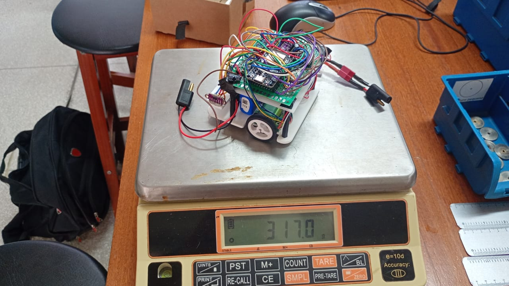

# Testes de Integração

Este documento planeja e registra os testes entre os subsistemas de Estruturas, Energia, Eletrônica e Software. As regras gerais de avaliação estão no [documento do tema do projeto](https://docs.google.com/presentation/d/1hRx0g9mpVGQbTv44gLEoAyf4b4kKM4vnrABTnG8HlUk/edit?usp=sharing).

> [!IMPORTANT]
> Os testes desta seção ainda não possuem evidência de execução integrada. Por isso, os resultados estão marcados como **pendentes** e os campos de aprovação permanecem sem preenchimento. Eles somente deverão ser alterados após a execução no robô físico, com as respectivas medições, fotografias e logs.

## 1. Sequência e dependências

1. Finalizar a soldagem, validar a continuidade elétrica e fixar a eletrônica no chassi (5.1).
2. Ajustar a bateria e os sensores e verificar o envelope dimensional (5.2, 5.3 e 5.5).
3. Validar a alimentação com o robô sob carga e integrar os drivers ao firmware (5.4 e 5.9).
4. Calibrar o controle e validar os sensores durante o movimento (5.7 e 5.8).
5. Executar a navegação autônoma e inspecionar novamente a estrutura (5.10 e 5.6).
6. Validar a telemetria, a interface e a tolerância à perda de conexão (5.11 a 5.13).

## 2. Planejamento e registro dos testes

| **ID** | **Descrição** | **Data de Início** | **Data de Conclusão** | **Sub-equipes** | **Responsável** | **Resultados Esperados** | **Resultados Obtidos** | **Aprovação Interna (S/N)** | **Aprovação do Orientador (S/N)** | **Observações** |
|:------:|---------------|:------------------:|:-----------------------:|----------------|-----------------|--------------------------|------------------------|:---------------------------:|:--------------------------------:|-----------------|
| 5.1 | Soldagem definitiva, continuidade elétrica, roteamento da fiação e fixação da perfboard no chassi | 26/10/2026 | 04/11/2026 | Eletrônica e Estruturas | A definir | Componentes e trilhas sem curtos; perfboard firme nos espaçadores M3; cabos sem contato com rodas, eixos ou campo de visão dos sensores | **Pendente — teste integrado não executado** | — | — | [Atividade #261](https://github.com/fcte-pi1/2026.2_PI1__Grupo2_Juliana/issues/261); bloqueia 5.2, 5.3 e 5.5 |
| 5.2 | Ajuste do centro de gravidade e da posição da bateria | 04/11/2026 | 09/11/2026 | Energia e Estruturas | A definir | Bateria firmemente fixada; robô estável em inclinações e acelerações, sem empinar nem interferir nas rodas ou na fiação | **Pendente — teste integrado não executado** | — | — | [Atividade #262](https://github.com/fcte-pi1/2026.2_PI1__Grupo2_Juliana/issues/262); depende de 5.1 |
| 5.3 | Fixação e alinhamento dos três VL53L0X e da IMU BNO085 | 04/11/2026 | 09/11/2026 | Eletrônica e Estruturas | A definir | Sensores frontal e laterais firmes, alinhados e sem obstrução; BNO085 rígida e ortogonal ao chassi, sem folga capaz de alterar o *yaw* | **Pendente — teste integrado não executado** | — | — | [Atividade #263](https://github.com/fcte-pi1/2026.2_PI1__Grupo2_Juliana/issues/263); depende de 5.1 |
| 5.4 | Estabilidade elétrica, consumo sob carga mecânica e autonomia | 04/11/2026 | 09/11/2026 | Energia e Eletrônica | A definir | ESP32 sem *brownout* nas partidas e reversões; corrente, tensão, temperatura e autonomia registradas; proteção de bateria crítica acionada no limite confirmado pela equipe de Energia | **Pendente — teste integrado não executado** | — | — | Confirmar antes do ensaio o limite de parada atualmente documentado como 6,6 V por 1 s |
| 5.5 | Verificação do envelope dimensional e do giro dentro da célula | 04/11/2026 | 04/11/2026 | Estruturas | A definir | Robô completo com no máximo 16,5 × 16,5 cm e capaz de girar 360° em uma célula de 18 × 18 cm sem tocar nas paredes | **Pendente — teste integrado não executado** | — | — | [Atividade #264](https://github.com/fcte-pi1/2026.2_PI1__Grupo2_Juliana/issues/264); depende de 5.1, 5.2 e 5.3 |
| 5.6 | Inspeção estrutural após as corridas de calibração e navegação | 13/11/2026 | 16/11/2026 | Estruturas | A definir | Ausência de trincas, folgas e deslocamento da fiação; parafusos, suportes e apoio em condições de uso; testes afetados repetidos após eventuais correções | **Pendente — teste integrado não executado** | — | — | [Atividade #265](https://github.com/fcte-pi1/2026.2_PI1__Grupo2_Juliana/issues/265); executar após 5.7, 5.8 e 5.10 |
| 5.7 | Calibração conjunta do controle PID com a massa real do robô | 04/11/2026 | 09/11/2026 | Software e Eletrônica | A definir | Constantes Kp, Ki e Kd registradas; robô parte, mantém a trajetória e freia sem oscilação persistente no piso real | **Pendente — teste integrado não executado** | — | — | Depende da montagem física e da liberação elétrica do robô |
| 5.8 | Sincronização e leitura dos VL53L0X durante o movimento | 04/11/2026 | 09/11/2026 | Software e Eletrônica | A definir | Três sensores inicializados sem conflito no barramento I²C; leituras frontal e laterais coerentes durante o movimento, sem corrupção causada por vibração ou pontos cegos | **Pendente — teste integrado não executado** | — | — | Registrar log das leituras e vídeo do robô em movimento |
| 5.9 | Unificação dos drivers de hardware no firmware principal | 04/11/2026 | 09/11/2026 | Software e Eletrônica | A definir | VL53L0X, BNO085, INA226, encoders e DRV8833 inicializados e operando simultaneamente no firmware principal, sem conflitos de GPIO ou de I²C | **Pendente — teste integrado não executado** | — | — | Registrar log completo de *boot* e funcionamento dos periféricos |
| 5.10 | Navegação autônoma com *Flood Fill* no labirinto físico | 09/11/2026 | 13/11/2026 | Software e Eletrônica | A definir | Partida em beco sem saída; detecção e atualização das paredes; decisão a cada célula; chegada encontrada sem intervenção humana | **Pendente — teste integrado não executado** | — | — | Rastreia RF23-S; registrar vídeo, mapa resultante e log da execução |
| 5.11 | Conexão Wi-Fi e envio de telemetria durante a navegação física | 13/11/2026 | 16/11/2026 | Software e Eletrônica | A definir | ESP32 transmite posição, bateria e estado durante o movimento sem bloquear o controle dos motores ou interromper a navegação | **Pendente — teste integrado não executado** | — | — | Depende de 5.10; registrar logs do ESP32 e do servidor |
| 5.12 | Renderização e latência do dashboard com dados do robô | 13/11/2026 | 16/11/2026 | Software | A definir | Mapa, bateria, velocidade e estado exibidos com os dados reais e latência de no máximo 500 ms entre a origem e a renderização | **Pendente — teste integrado não executado** | — | — | Rastreia RNF06-S; medir pela comparação dos *timestamps* de origem e exibição |
| 5.13 | Tolerância à falha de Wi-Fi, armazenamento local e reconexão | 13/11/2026 | 16/11/2026 | Software e Eletrônica | A definir | Navegação continua durante a queda; pacotes ficam armazenados localmente; evento de reconexão e pendências são enviados sem lacunas ou duplicidades após o retorno da rede | **Pendente — teste integrado não executado** | — | — | Rastreia RF25-S, RNF12-S e RNF15-S; comparar pacotes gerados, recebidos e persistidos |

## 3. Evidências mínimas

Cada teste deverá possuir evidências identificadas pelo respectivo ID. Conforme o tipo de ensaio, devem ser anexados:

- fotografias da montagem e das medições;
- vídeos das corridas, manobras e falhas simuladas;
- logs do ESP32, do servidor e do navegador;
- planilhas ou arquivos CSV com tensão, corrente, temperatura, autonomia e latência;
- mapa reconstruído, trajeto percorrido e contagem dos pacotes de telemetria;
- descrição das falhas encontradas, correções aplicadas e repetições realizadas.

Os arquivos de evidência deverão usar nomes descritivos iniciados pelo ID do teste, por exemplo `5.5-medicao-largura.jpeg` e `5.12-latencia.csv`.

## 4. Registro de hardware e estrutura (4.1.4)

Este registro reúne as evidências da montagem mecânica e os resultados já documentados pela equipe de Estruturas. Ele apoia as atividades [#266](https://github.com/fcte-pi1/2026.2_PI1__Grupo2_Juliana/issues/266), [#267](https://github.com/fcte-pi1/2026.2_PI1__Grupo2_Juliana/issues/267) e [#268](https://github.com/fcte-pi1/2026.2_PI1__Grupo2_Juliana/issues/268). Os resultados dos testes estruturais abaixo não substituem a execução e aprovação dos testes integrados da seção 2.

### 4.1 Montagem e evidências fotográficas

O robô utiliza três patamares de acrílico, espaçadores de nylon e suportes impressos para os motores. Na montagem registrada, a bateria foi posicionada no patamar inferior, a perfboard com ESP32 no topo e os sensores no patamar intermediário. As imagens disponíveis mostram o encaixe dos componentes; a configuração final e a fixação definitiva ainda precisam ser conferidas pela equipe.

| Evidência | Situação |
|---|---|
| [Robô montado, vista isométrica](../mec/testes/teste-1.8-robo-montado-isometrica.jpeg) | Disponível; confirmar se corresponde à montagem final. |
| [Perfboard e componentes, vista superior](../mec/testes/teste-1.8-perfboard-componentes-superior.jpeg) | Disponível; confirmar se corresponde à montagem final. |
| [Bateria no chassi, vista lateral](../mec/testes/teste-1.8-encaixe-bateria-lateral.jpeg) | Disponível como registro de encaixe. |
| [Sensores, vista frontal](../mec/testes/teste-1.11-sensores-frontal.jpeg) | Disponível; na ocasião os sensores foram testados deitados, sem suporte definitivo. |
| Foto atual do robô completo, em perspectiva | **Pendente de inclusão.** |
| Foto atual do robô completo, vista superior | **Pendente de inclusão.** |
| Fotos da fixação final da bateria, sensores e passagem dos cabos | **Pendentes de inclusão e conferência.** |

### 4.2 Pesagem e medidas

| Medição | Valor registrado | Evidência ou ação pendente |
|---|---|---|
| Massa do chassi, sem motores e eletrônica | 82,5 g | [Foto da pesagem](../mec/testes/teste-1.9-pesagem-chassi.jpeg). Não representa a massa do robô completo. |
| Massa do robô montado | 317,0 g | Foto abaixo; confirmar se a configuração fotografada corresponde à montagem final. |
| Largura do robô montado | Cerca de 12 cm, estimativa do teste 1.7 | Medir a configuração final e anexar foto com régua ou trena. |
| Comprimento do robô completo | **Pendente** | Medir a configuração final e anexar foto com régua ou trena. |
| Altura do robô completo | **Pendente** | Registrar a medida e a foto, se necessária para documentar a configuração final. |

*Pesagem do robô na configuração apresentada na fotografia: 317,0 g.*

O teste integrado 5.5 exige verificar o limite de 16,5 × 16,5 cm e o giro dentro de uma célula de 18 × 18 cm. A estimativa existente não comprova a execução desse teste; registrar as medidas e o resultado após a verificação.

### 4.3 Relato dos testes mecânicos existentes

Os resultados a seguir foram transcritos de forma resumida dos [Testes de estrutura](./7.1%20-%20Testes%20de%20estrutura.md), onde estão os procedimentos e demais evidências. Devem ser conferidos com a equipe antes de acrescentar informações sobre novas execuções.

| Teste | Resultado registrado | Evidência ou complemento |
|---|---|---|
| 1.1 a 1.3 — inventário, medidas das peças e suportes dos motores | Peças conferidas; medidas dos patamares dentro da tolerância informada e suportes verificados. | Fotos das peças e medições disponíveis no documento de testes. |
| 1.4 e 1.5 — montagem e comparação com CAD | Estrutura montada e comparada ao CAD; foram acrescentados espaçadores de 15 mm sobre os de 30 mm no topo. | [Foto da estrutura](../mec/testes/teste-1.5-estrutura-real-isometrica.jpeg) e [imagem do CAD atualizado](../mec/modelos-cad/teste-1.5-cad-isometrica.jpeg). |
| 1.6 — nivelamento | O ball caster adquirido não coube na altura prevista; o nivelamento nos quatro cantos não foi medido. | Registrar a solução adotada e as medidas após nova verificação. |
| 1.7 a 1.9 — dimensões, encaixe e massa | Largura estimada em cerca de 12 cm; encaixe dos componentes verificado; chassi sem motores e eletrônica com 82,5 g. | Completar com medidas e pesagem do robô final na seção 4.2. |
| 1.10 — rigidez | Carga de 300 g por 5 minutos; deflexão registrada dentro de 0,5 mm e ausência de trincas após retirada da carga. | **Foto do ensaio pendente**, caso disponível. |
| 1.11 e 1.12 — sensores e cabos | Visão dos sensores e passagem dos cabos verificadas na configuração registrada; sensores ainda sem suporte definitivo. | [Sensores](../mec/testes/teste-1.11-sensores-frontal.jpeg) e [cabos](../mec/testes/teste-1.12-passagem-cabos.jpeg); complementar após fixação final. |
| 1.13 a 1.16 — labirinto | O documento de estrutura registra verificações de encaixe, colisão, dimensões das células e piso. | **Fotos dos ensaios pendentes**, caso disponíveis; consultar o relato original para os resultados de cada teste. |

Para cada nova evidência, registrar a data, a configuração do robô, a medição ou resultado observado e o teste correspondente. Fotos adicionais podem ser guardadas em `mec/testes/` e vinculadas aqui. Resultados integrados e aprovações na seção 2 só devem ser preenchidos quando confirmados pela equipe.

## 5. Referências

- [Requisitos do projeto](./2%20-%20Requisitos.md)
- [Projeto conceitual de estruturas](./4.1%20-%20Projeto%20conceitual%20de%20estruturas.md)
- [Projeto conceitual de energia](./4.2%20-%20Projeto%20conceitual%20de%20energia.md)
- [Projeto conceitual de hardware](./4.3%20-%20Projeto%20conceitual%20de%20hardware.md)
- [Roteiro de testes funcionais](./4.4.6%20-%20Roteiro%20de%20testes%20funcionais.md)
- [Contrato de telemetria](./4.4.7%20-%20Contrato%20de%20Telemetria.md)
- [Testes de estrutura](./7.1%20-%20Testes%20de%20estrutura.md)
- [Testes de energia](./7.2%20-%20Testes%20de%20energia.md)
- [Testes de hardware](./7.3%20-%20Testes%20de%20hardware.md)
- [Testes de software](./7.4%20-%20Testes%20de%20software.md)
