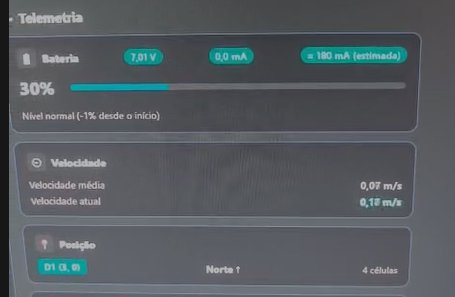

# Teste 5.10 — Leitura de bateria via INA226 e validação de indicadores

## 1. Objetivo

Leitura de bateria (tensão, percentual e corrente via INA226) e validação dos indicadores.

**Critério esperado:** Tensão, percentual e corrente da bateria lidos corretamente pelo firmware/INA226, validados contra multímetro e coerentes com indicadores analógicos.

## 2. Pré-requisitos e dependências

- Depende de `5.1` e `5.9`.
- Versão de hardware/chassi/firmware utilizada: Segunda versão do chassi do Micromouse com sensor INA226 no barramento I2C e módulo de monitoramento de bateria (`src/firmware/lib/energia/monitor_bateria.cpp`) integrado à telemetria.

## 3. Procedimento executado

1. Validação prévia do corte de bateria crítica no robô físico antes da integração com o software.
2. Energização do Micromouse pela bateria LiPo 2S com o módulo INA226 ativo e envio contínuo de telemetria ao painel web.
3. Execução de deslocamento do robô com monitoramento em tela da tensão medida, do percentual de carga, do indicador de nível e da corrente estimada pelo acionamento das rodas.
4. Verificação da coerência entre a tensão medida e a curva linear de percentual definida no Contrato de Telemetria (`4.4.7`) e em `monitor_bateria.h` (`6,4 V = 0%` a `8,4 V = 100%`).

## 4. Resultados e medições

- **Status:** Concluído e aprovado internamente.
- **Tensão da bateria (INA226):** `7,01 V`.
- **Percentual de carga e indicador de estado:** `30%` — **Nível normal** (`-1% desde o início`), coerente com o cálculo linear sobre `7,01 V` na faixa de `6,4 V` a `8,4 V` (`≈ 30,5%`).
- **Corrente:** leitura direta reportada em `0,0 mA` na captura, com estimativa de consumo pelas rodas em **`≈ 180 mA (estimada)`**.
- **Validação de proteção:** corte de bateria crítica validado no robô físico antes da integração com o software, além dos testes unitários do módulo `MonitorBateria` em `src/firmware/test/test_bateria/test_bateria.cpp`.

## 5. Evidências

- Salvar fotografias, logs (`.txt`), planilhas/medições (`.csv`) e prints em `../evidencias/integracao/5.10/` (máximo 5 MB por arquivo).
- Hospedar vídeos no Google Drive ou YouTube e informar apenas o link abaixo.

| Evidência | Arquivo ou Link | Observação |
|---|---|---|
| Vídeo do ensaio com o robô em movimento | [YouTube Shorts](https://youtube.com/shorts/2c-H9WN0ZdM?feature=share) | Validação da leitura de bateria e comportamento do robô em deslocamento |
| Tela de telemetria da bateria | [5.4-5.10-telemetria-bateria-ina226.jpg](../figs/energia/5.4-5.10-telemetria-bateria-ina226.jpg) | Exibição de 7,01 V, 30% (nível normal) e ≈ 180 mA estimados |

  
   <em>Figura 1 — Painel de telemetria validando a leitura de tensão (7,01 V), percentual (30%, nível normal) e corrente estimada pelas rodas (≈ 180 mA).</em>

  
   <em>Vídeo 1 — Clique na miniatura para assistir ao ensaio no YouTube Shorts.</em>

## 6. Problemas encontrados e ações corretivas

- Nenhum problema encontrado relativo à bateria.
