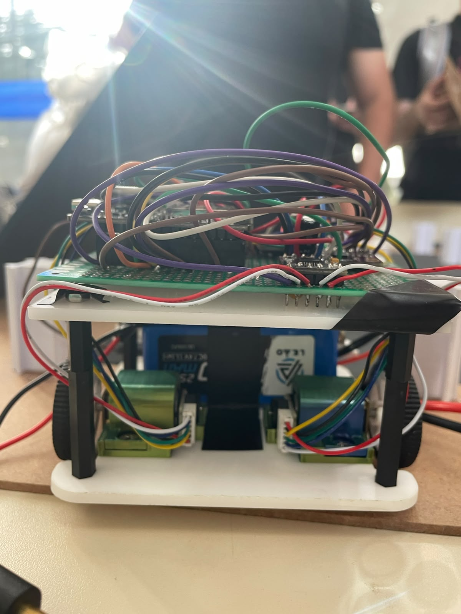

# Teste 5.2 — Ajuste do centro de gravidade e posição da bateria

## 1. Objetivo

Ajuste do centro de gravidade e da posição da bateria.

**Critério esperado:** Bateria firmemente fixada; robô estável em inclinações e acelerações, sem empinar nem interferir nas rodas ou na fiação.

## 2. Pré-requisitos e dependências

- Montagem física com a bateria no patamar inferior. Depende do teste 5.1.

## 3. Procedimento executado

A equipe verificou a posição e a fixação da bateria e avaliou a estabilidade do conjunto durante o ensaio. A montagem manteve a bateria no patamar inferior. Os detalhes sobre inclinações, acelerações e folgas ainda precisam ser confirmados com os responsáveis.

## 4. Resultados e medições

- Verificação qualitativa concluída segundo a equipe. O centro de gravidade não foi quantificado no registro disponível.
- Registro atualizado em 24/11/2026. A data de execução ainda precisa ser confirmada.

## 5. Evidências

## 6. Problemas encontrados e ações corretivas

- A equipe confirmou a conclusão da verificação. Ajustes específicos não constam no relato.
