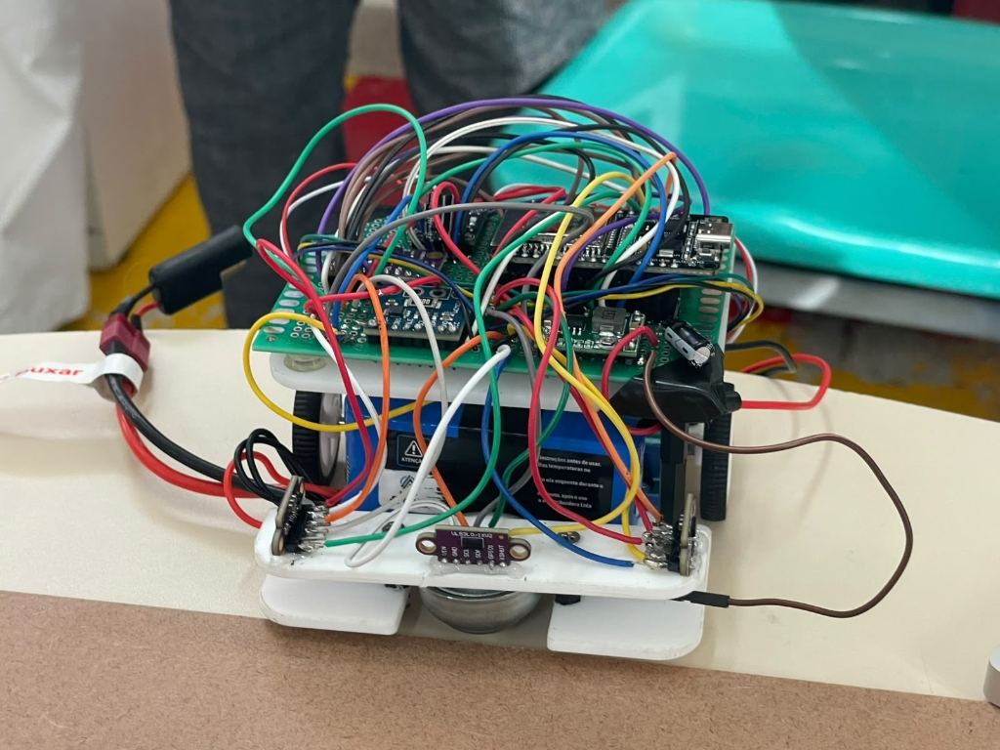

# Teste 5.2 — Ajuste do centro de gravidade e posição da bateria

## 1. Objetivo

Ajuste do centro de gravidade e da posição da bateria.

**Critério esperado:** Bateria firmemente fixada; robô estável em inclinações e acelerações, sem empinar nem interferir nas rodas ou na fiação.

## 2. Pré-requisitos e dependências

- Montagem física com a bateria no patamar inferior. Depende de `5.1`.
- Versão de hardware/chassi/firmware utilizada: Segunda versão do chassi do Micromouse.

## 3. Procedimento executado

1. Posicionamento e fixação da bateria LiPo 2S na região central do patamar inferior da segunda versão do chassi, alinhada ao eixo das rodas e acima da esfera deslizante (*ball caster*).
2. Verificação física da folga entre a bateria, os conectores/fiação e as rodas motrizes.
3. Avaliação da estabilidade do robô montado (com perfboard, sensores VL53L0X e eletrônica completa) para assegurar distribuição equilibrada de massa e ausência de tombamento ou empinamento.

## 4. Resultados e medições

- **Status:** Concluído e aprovado internamente (registro atualizado em 24/11/2026).
- A bateria permaneceu firmemente posicionada na região central do patamar inferior da segunda versão do chassi, concentrando a massa na parte inferior e mantendo o centro de gravidade baixo e equilibrado.
- Não foi observada interferência da bateria ou de seus cabos com as rodas motrizes nem com o campo de visão dos sensores frontais e laterais.

## 5. Evidências

| Evidência | Arquivo ou Link | Observação |
|---|---|---|
| Montagem do Micromouse (2ª versão do chassi) | [5.2-centro-gravidade-bateria.jpg](../figs/energia/5.2-centro-gravidade-bateria.jpg) | Posicionamento central da bateria LiPo 2S no patamar inferior da segunda versão do chassi |
| Robô completo com bateria no patamar inferior | [5.2-robo-completo-bateria.png](../evidencias/integracao/5.2/5.2-robo-completo-bateria.png) | Vista adicional da montagem física com a bateria visível no patamar inferior |

  
   <em>Figura 1 — Segunda versão do chassi do Micromouse com a bateria LiPo 2S centralizada no patamar inferior.</em>

  
   <em>Figura 2 — Robô montado com a bateria visível no patamar inferior.</em>

## 6. Problemas encontrados e ações corretivas

- Nenhum problema foi encontrado.
