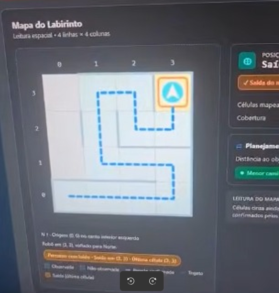
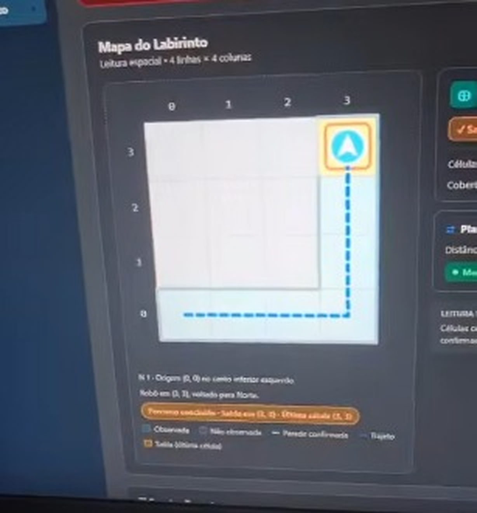

# Teste 5.22 — Histórico, exportação CSV/PDF, logs e integridade CRC16 na interface web

## 1. Objetivo

Telemetria em tempo real na interface web: histórico, exportação CSV/PDF, logs e CRC16.

**Critério esperado:** Pelo menos 3 percursos salvos individualmente (RF07-S a RF10-S), filtros no histórico, exportação CSV/PDF consistente com o serial (RF18-S), logs (RF20-S) e descarte CRC16 (RF24-S).

## 2. Pré-requisitos e dependências

- Depende de `5.19` e `5.20`.
- Versão de hardware/chassi/firmware utilizada: *A preencher durante a execução.*

## 3. Procedimento executado

### 3.1 Gravação de demonstração e sincronia robô ↔ Dashboard ([#290](https://github.com/fcte-pi1/2026.2_PI1__Grupo2_Juliana/issues/290), 4.1.6.1)

1. Posicionar o robô físico no labirinto e abrir o Dashboard do sistema web no navegador.
2. Iniciar a corrida e gravar o robô navegando no labirinto junto com a tela do Dashboard atualizando em tempo real.
3. Publicar os vídeos no YouTube (público) e registrar os links na seção 5.

## 4. Resultados e medições

- **Status:** Pendente — aguardando registro da frente.
- **Gravação de demonstração (#290):** vídeos gravados em 24/11/2026 e publicados no YouTube (ver seção 5). Nas duas corridas, o Mapa do Labirinto (4 × 4) do Dashboard acompanhou o trajeto do robô e exibiu "Percurso concluído", com saída em (3, 3).

<table>
  <tr>
    <td align="center"> Vídeo 1: percurso concluído</td>
    <td align="center"> Vídeo 2: percurso concluído</td>
  </tr>
</table>
- *Registrar medições obtidas, datas reais de início/conclusão e atualizar os campos do cabeçalho YAML acima.*

## 5. Evidências

- Salvar fotografias, logs (`.txt`), planilhas/medições (`.csv`) e prints em `../evidencias/integracao/5.22/` (máximo 5 MB por arquivo).
- Hospedar vídeos no Google Drive ou YouTube e informar apenas o link abaixo.

| Evidência | Arquivo ou Link | Observação |
|---|---|---|
| Vídeo 1 — robô no labirinto + Dashboard em tempo real | [YouTube](https://www.youtube.com/shorts/UWa7T35zo_U) | Gravado em 24/11/2026 (#290) |
| Vídeo 2 — robô no labirinto + Dashboard em tempo real | [YouTube](https://www.youtube.com/shorts/azfPo6WvnlY) | Gravado em 24/11/2026 (#290) |
| Print da tela de sucesso — vídeo 1 | [5.22-video1-tela-sucesso.png](../figs/software/5.22-video1-tela-sucesso.png) | Percurso concluído, saída em (3, 3) (#290) |
| Print da tela de sucesso — vídeo 2 | [5.22-video2-tela-sucesso.png](../figs/software/5.22-video2-tela-sucesso.png) | Percurso concluído, saída em (3, 3) (#290) |
| Histórico, exportação CSV/PDF, logs e CRC16 | `../evidencias/integracao/5.22/...` | Pendente (#283) |

## 6. Problemas encontrados e ações corretivas

- *Registrar eventuais falhas encontradas, ajustes aplicados e repetições realizadas.*
