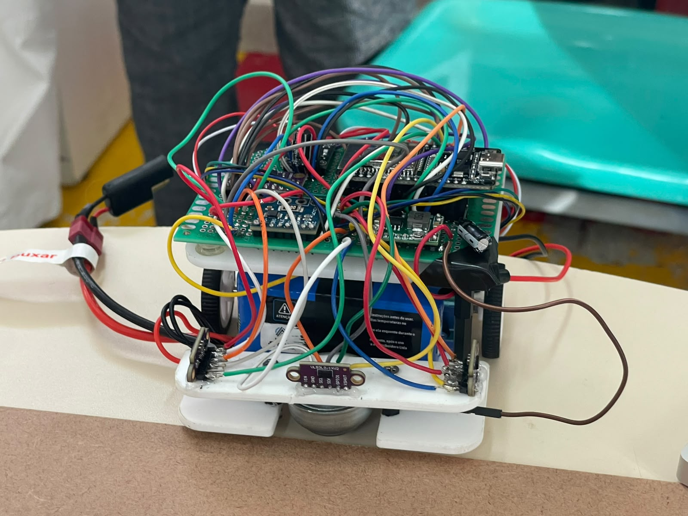
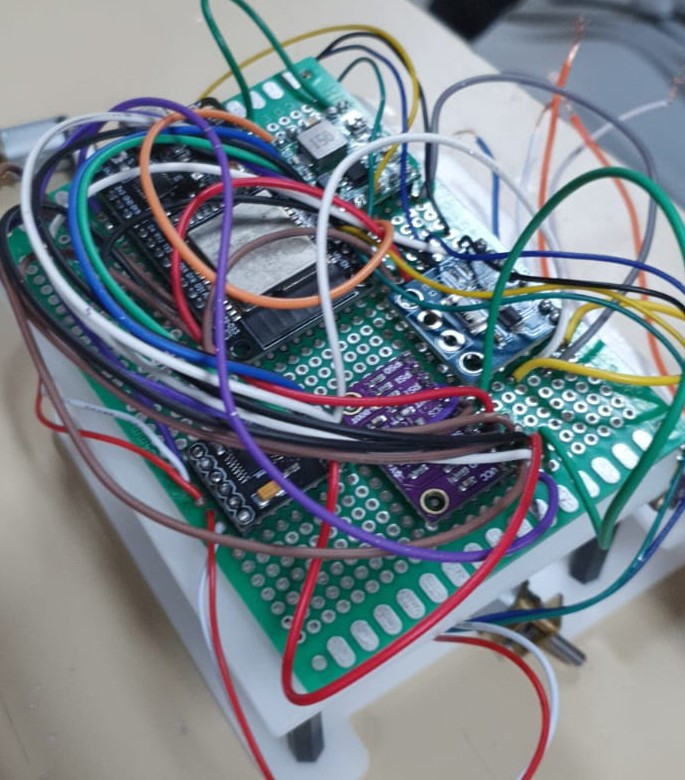

# Teste 5.3 — Fixação e alinhamento dos sensores VL53L0X e BNO085

## 1. Objetivo

Fixação e alinhamento geométrico dos três VL53L0X e da IMU BNO085.

**Critério esperado:** Sensores frontal e laterais firmes, alinhados e sem obstrução; BNO085 rígida e ortogonal ao chassi, sem folga capaz de alterar o yaw.

## 2. Pré-requisitos e dependências

- Depende de `5.1`.
- Versão de hardware/chassi/firmware utilizada: *A preencher durante a execução.*

## 3. Procedimento executado

1. Foram identificadas as posições de instalação ideais para melhor aproveitamento dos três sensores VL53L0X no chassi, correspondentes às orientações frontal e laterais do robô.
2. Os sensores VL53L0X foram posicionados e fixados em seus respectivos locais da plataforma intermediária do chassi, respeitando a disposição geométrica planejada e garantindo assim a detecção de paredes/objetos de forma efetiva.
3. Foi realizada a fixação da IMU BNO085 na perfboard anexada ao chassi, buscando manter sua orientação conforme os eixos de referência do robô.
4. Após a instalação, foi realizada uma inspeção visual para verificar a firmeza dos componentes, o posicionamento dos sensores e a ausência de obstruções físicas.
5. Foi verificada a estabilidade da montagem, observando se os componentes apresentavam folgas ou movimentações indesejadas.

## 4. Resultados e medições

- **Status:** Concluído.
- Os três sensores VL53L0X foram fixados nas posições previstas para detecção frontal e lateral.
- A IMU BNO085 foi instalada e fixada ao chassi.
- A montagem dos componentes ocorreu sem dificuldades significativas.
- Não foram identificados problemas que impedissem a conclusão da fixação dos sensores e da IMU.

A montagem física foi concluída satisfatoriamente, atendendo aos requisitos de instalação e fixação dos componentes.

## 5. Evidências

| Evidência | Arquivo ou Link | Observação |
|---|---|---|
| Fotografia |  | Registro da fixação dos três sensores VL53L0X no chassi (os 3 componentes no andar intermediário). |
| Fotografia |  | Registro da instalação da IMU BNO085 (componente roxo). |

## 6. Problemas encontrados e ações corretivas

Não foram encontrados problemas significativos durante a execução do procedimento. A fixação dos três sensores VL53L0X e da IMU BNO085 ocorreu conforme planejado, não sendo necessárias ações corretivas ou repetições do procedimento.
