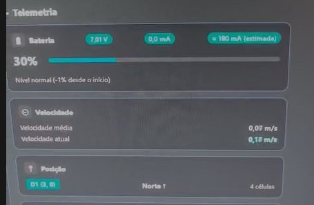

# Teste 5.4 — Estabilidade elétrica, consumo sob carga mecânica e autonomia

## 1. Objetivo

Ensaio de estabilidade elétrica, consumo sob carga mecânica e autonomia.

**Critério esperado:** ESP32 sem brownout nas arrancadas e reversões; tensão, corrente, temperatura e autonomia registradas; corte de bateria crítica validado.

## 2. Pré-requisitos e dependências

- Depende de `5.1` e `5.2`.
- Versão de hardware/chassi/firmware utilizada: Segunda versão do chassi do Micromouse com bateria LiPo 2S (7,4 V / 1500 mAh), regulador Step-Down MP1584, sensor INA226 e firmware integrado de telemetria.

## 3. Procedimento executado

1. Validação prévia do corte de bateria crítica diretamente no robô físico antes da integração com o software.
2. Energização do Micromouse pela bateria LiPo 2S na segunda versão do chassi.
3. Execução de deslocamento do robô com os motores N20 sob carga mecânica, acompanhando a estabilidade de alimentação do ESP32 e as leituras de tensão, percentual e consumo estimado pelas rodas na tela de telemetria.

## 4. Resultados e medições

- **Status:** Concluído e aprovado internamente.
- **Estabilidade elétrica sob carga:** O Micromouse deslocou-se normalmente sem apresentar *brownout* ou reinicializações do ESP32 durante o acionamento dos motores.
- **Medições em operação (telemetria):**
  - **Tensão da bateria:** `7,01 V` (`30%` de carga, status **Nível normal**, variação de `-1% desde o início`).
  - **Corrente estimada pelas rodas:** `≈ 180 mA` (potência elétrica estimada de aproximadamente `1,26 W` no ponto medido).
- **Autonomia:** considerando a capacidade utilizável de 80% da bateria LiPo 2S de 1500 mAh (`1200 mAh` úteis, conforme `4.2`), a faixa de consumo estimada de `≈ 180 mA` atende com ampla margem à autonomia mínima de 30 minutos (`RNF-01-EN`).
- **Corte de bateria crítica:** validado no robô físico antes da integração com o software (em consonância com os limiares do firmware em `monitor_bateria.h`: aviso em `< 7,0 V` e parada em `< 6,6 V`).

## 5. Evidências

- Salvar fotografias, logs (`.txt`), planilhas/medições (`.csv`) e prints em `../evidencias/integracao/5.4/` (máximo 5 MB por arquivo).
- Hospedar vídeos no Google Drive ou YouTube e informar apenas o link abaixo.

| Evidência | Arquivo ou Link | Observação |
|---|---|---|
| Vídeo do ensaio em movimento | [YouTube Shorts](https://youtube.com/shorts/2c-H9WN0ZdM?feature=share) | Micromouse em deslocamento sob carga da bateria sem brownout |
| Tela de telemetria durante o ensaio | [5.4-5.10-telemetria-bateria-ina226.jpg](../figs/energia/5.4-5.10-telemetria-bateria-ina226.jpg) | Leitura de 7,01 V (30%) e corrente estimada de ≈ 180 mA |

  
   <em>Figura 1 — Tela de telemetria durante o ensaio sob carga: 7,01 V (30%) e corrente estimada de ≈ 180 mA.</em>

  
   <em>Vídeo 1 — Clique na miniatura para assistir ao ensaio no YouTube Shorts.</em>

## 6. Problemas encontrados e ações corretivas

- Nenhum problema encontrado relativo à bateria ou à estabilidade elétrica.
